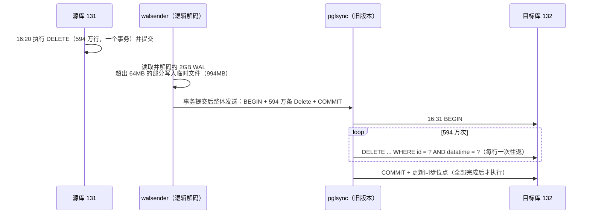

# 案例复盘：超表大批量 DELETE 后目标库迟迟没有同步

> 时间：2026-11-18  
> 环境：测试环境，源库 192.168.234.131 → 目标库 192.168.234.132，Python 版 pglsync  
> 涉及表：`public.tcensemblerealtime`（TimescaleDB 超表）

本文按时间顺序整理了这次问题的现象、排查过程、原因、代码修改、恢复操作和优化建议，方便以后遇到类似情况时对照排查。

---

## 目录

- [1. 问题现象](#1-问题现象)
- [2. 排查过程](#2-排查过程)
- [3. 根本原因](#3-根本原因)
- [4. 代码修改](#4-代码修改)
- [5. 恢复操作（不使用 systemd 的完整命令）](#5-恢复操作不使用-systemd-的完整命令)
- [6. 优化建议及其原理](#6-优化建议及其原理)
- [7. 业务上大批量删除的最佳实践](#7-业务上大批量删除的最佳实践)
- [8. 一些容易误解的点](#8-一些容易误解的点)
- [9. 排查速查表](#9-排查速查表)

---

## 1. 问题现象

在源库执行了一条大范围删除：

```sql
DELETE FROM tcensemblerealtime
WHERE datatime BETWEEN '2026-08-19 00:00:00' AND '2026-11-19 00:00:00';
-- 删除 5,947,546 行（删除前共 14,294,282 行）
```

之后发现**目标库没有任何变化**。当时 `status` 的输出：

```
== 源库复制槽 pglsync_test_slot ==
  插件            : pgoutput
  是否活跃        : 是 (pid 104948)
  当前 WAL 位置   : 58/C0FAF8C8
  已确认位点      : 58/A4FFFFB0  (落后 448 MB)
  保留 WAL        : 2061 MB  (restart_lsn 58/40249330)
  wal_status      : extended
== 源库发布 pglsync_test_pub ==
  存在
== 目标库同步位点 ==
  位点 58/402438E8，更新于 2026-11-18 08:20:03.509941+00:00
```

---

## 2. 排查过程

### 2.1 解读 status 输出

| 输出项 | 含义 | 结论 |
|---|---|---|
| 是否活跃：是 | 同步进程还连着复制槽 | 进程没挂 |
| 目标库同步位点 `58/402438E8`，更新于 08:20 UTC（16:20） | 目标库已经二十多分钟没有提交过新数据 | 卡在 DELETE 之前的位置 |
| `restart_lsn 58/40249330` | 和目标库位点几乎相同 | 源库在为某个还没处理完的事务保留 WAL |
| 保留 WAL 2061 MB | 从 restart_lsn 到当前一共保留了约 2GB WAL | 这个事务很大 |
| 已确认位点比目标库位点靠前 | 源库解码大事务期间会发心跳，pglsync 在空闲时据此推进了确认位点 | **不会丢数据**：大事务提交位置在确认位点之后，会被完整发送；restart_lsn 仍停在它前面 |

初步判断：**有一个超大事务正在处理中，数据没有丢。**

### 2.2 三条验证 SQL 及实际结果

**① 源库：逻辑解码的统计**

```sql
SELECT slot_name, spill_txns, pg_size_pretty(spill_bytes) AS spill,
       total_txns, pg_size_pretty(total_bytes) AS total
FROM pg_stat_replication_slots;
```

```
pglsync_test_slot | 2 | 994 MB | 104776 | 189 MB
```

`spill = 994 MB`：有事务大到超出解码内存，写了约 1GB 临时文件。**说明大事务已经在源库解码，并开始发送。**

**② 目标库：pglsync 的连接在做什么**

```sql
SELECT pid, state, xact_start, now() - xact_start AS 已持续, left(query, 60) AS query
FROM pg_stat_activity WHERE application_name = 'pglsync';
```

```
4026460 | idle in transaction | 2026-11-18 08:31:41+00 | 00:26:58 | DELETE FROM "public"."tcensemblerealtime" WHERE "id" = '1239...
```

- 从 16:31:41 开始了一个事务，已持续 27 分钟；
- 最后一条语句是**单行**的 `DELETE ... WHERE "id" = ...`；
- 状态 `idle in transaction`：采样时正处在两条语句之间。逐行执行时，大部分时间都花在网络往返和客户端处理上。

**说明：同步程序正在目标库上逐行执行删除，事务还没提交。**

**③ 源库：相关 chunk 是否被压缩**

```sql
SELECT chunk_name, range_start, range_end, is_compressed
FROM timescaledb_information.chunks
WHERE hypertable_name = 'tcensemblerealtime'
  AND range_end > '2026-08-19' AND range_start < '2026-11-19'
ORDER BY range_start;
```

```
_hyper_2_14_chunk | 2026-03-08 00:00:00+00 | 2027-03-03 00:00:00+00 | false
```

未压缩，**排除了“压缩数据的删除不会产生逐行变更、因而无法捕获”这种可能**。同时也看到：这张表的一个 chunk 覆盖了**将近一年**（这一点和第 8.1 节有关）。

---

## 3. 根本原因

### 3.1 一句话

**数据没有丢。旧版本 pglsync 把 594 万条删除逐行发给目标库（一行一条 DELETE 语句、一次网络往返），整个事务要全部执行完才提交，所以目标库长时间看不到任何变化。**

### 3.2 大事务在同步流程中的完整经过



每一步的影响：

1. **源库解码**：必须读完整个事务的 WAL，超出 `logical_decoding_work_mem`（默认 64MB）的部分写临时文件。这一步大约用了十几分钟（16:20 → 16:31）。
2. **按提交顺序发送**：大事务提交后才整体发出；它后面的所有事务都要排队。
3. **目标库逐行执行**：594 万次网络往返，按每秒一两千行估算要 40～100 分钟。
4. **全部完成才提交**：目标库在这之前看不到任何删除，同步位点也不会推进。

### 3.3 为什么说不会丢数据

- 目标库上这个事务没有提交。进程中断时，PostgreSQL 会自动回滚，不会留下删了一半的数据；
- 复制槽的 `restart_lsn` 停在这个事务之前，所需的 WAL 都还保留着；
- 已确认位点没有越过这个事务的提交位置，重启后会被完整重新发送。

---

## 4. 代码修改

以下修改 Python 版和 Java 版都已实现，并推送到 GitHub 的 `test/local-vm-env` 和 `feature/java-springboot` 两个分支。

### 4.1 批量执行 DELETE（解决主要问题）

**修改前**：每条删除单独执行。

```sql
DELETE FROM "public"."tcensemblerealtime" WHERE "id" = '1' AND "datatime" = '...';
DELETE FROM "public"."tcensemblerealtime" WHERE "id" = '2' AND "datatime" = '...';
-- ……共 594 万条
```

**修改后**：同一张表连续的删除，每 `upsert_group_size`（默认 500）行合并成一条。

```sql
DELETE FROM "public"."tcensemblerealtime"
WHERE ("id", "datatime") IN (VALUES
  ('1'::bigint, '...'::timestamp with time zone),
  ('2'::bigint, '...'::timestamp with time zone),
  ...                                         -- 共 500 组
);
```

- 网络往返从约 594 万次减少到约 1.2 万次；
- VALUES 中带上主键列的类型（从复制流的表结构信息中获取），否则 PostgreSQL 会把这些值当作 text，和 bigint、timestamptz 列比较时报类型不匹配；
- 某一列的类型无法确定时，自动退回逐行删除，保证正确性；
- **顺序保证**：遇到同一张表的 INSERT/UPDATE，或其他表的操作时，先把已合并的删除执行掉，变更顺序和源库完全一致。

### 4.2 大事务进度日志

同一个事务每处理 10 万条变更，日志输出一行：

```
正在应用大事务 xid=123456：已处理 1200000 条变更，耗时 85s（整个事务完成后才会提交到目标库）
```

旧版本只在空闲时输出统计信息，处理大事务期间日志完全没有动静，很难判断程序是否在工作。

### 4.3 停止时不再等待大事务完成

| | 旧版本 | 新版本 |
|---|---|---|
| 收到停止信号（Ctrl+C / kill / systemctl stop），且正在应用一个事务 | 等这个事务全部处理完才退出（这次可能要等一个多小时） | **回滚目标库上未提交的部分，立即退出**；重启后从目标库保存的位点重新接收，不丢数据 |
| 正好处在两个事务之间 | 提交已完成的批次后退出 | 相同 |

### 4.4 文档

[USER_GUIDE.md](USER_GUIDE.md) 的常见问题里增加了两条：“大事务处理中、目标库迟迟没有变化”和“压缩 chunk 的删除不会被同步”。

---

## 5. 恢复操作（不使用 systemd 的完整命令）

这次的同步进程是用 `python3` 命令直接运行的，没有配置成 systemd 服务。恢复步骤如下，都在 131 上执行：

```bash
# 1. 进入程序目录
cd /opt/cdc-pgtables-sync
C=config.test.json

# 2. 停掉旧进程（旧版本按 Ctrl+C 会等大事务做完才退出，所以要强制结束）
pgrep -af "pglsync.*run"                    # 查看旧进程
kill -9 $(pgrep -f "pglsync.*run")          # 强制结束
pgrep -af "pglsync.*run"                    # 没有输出说明已经停掉

# 3. 确认目标库上的连接已断开（返回 0 行即可）
psql -h 192.168.234.132 -U postgres -d typhoon -c \
  "SELECT pid, state, xact_start FROM pg_stat_activity WHERE application_name = 'pglsync';"

# 4. 更新代码并自检
git pull
python3 -m unittest discover -s tests       # 最后应显示 OK

# 5.（可选）调大源库的解码内存，不需要重启数据库
psql -h 192.168.234.131 -U postgres -d typhoon -c "ALTER SYSTEM SET logical_decoding_work_mem = '256MB';"
psql -h 192.168.234.131 -U postgres -d typhoon -c "SELECT pg_reload_conf();"

# 6. 在后台启动新版本（关掉终端、断开 SSH 后也会继续运行）
mkdir -p logs
nohup python3 -m pglsync -c $C run > logs/pglsync-run.out 2>&1 &
echo $! > logs/pglsync.pid
ps -fp $(cat logs/pglsync.pid)

# 7. 观察日志（按 Ctrl+C 只是退出查看，不影响同步进程）
tail -f logs/pglsync-test.log
#    依次出现：开始增量同步 → 正在应用大事务…已处理 N 条 → 统计: …（说明大事务已提交）
#    没有任何日志时，查看启动输出：tail -n 50 logs/pglsync-run.out

# 8. 查看状态：目标库同步位点应从 58/402438E8 往前推进
python3 -m pglsync -c $C status

# 9. 完成后核对：两边应该都是 14294282 - 5947546 = 8346736 行（删除后两边都没有新写入时）
python3 -m pglsync -c $C reconcile -t public.tcensemblerealtime
python3 -m pglsync -c $C reconcile -t public.tcensemblerealtime --detail   # 有不一致时列出具体行
```

**为什么 `kill -9` 是安全的：**

- 目标库上的事务没有提交，连接断开后 PostgreSQL 会自动回滚；
- 这个事务从来没有向源库确认过，重启后会从目标库保存的位点重新接收；
- 代价只是源库要重新解码一次（几分钟），以及之前已经执行的那部分删除要重做。

**以后的日常启停：**

```bash
cd /opt/cdc-pgtables-sync && C=config.test.json
kill $(cat logs/pglsync.pid)                                      # 停止（新版本会正常退出）
nohup python3 -m pglsync -c $C run > logs/pglsync-run.out 2>&1 &  # 启动
echo $! > logs/pglsync.pid
```

---

## 6. 优化建议及其原理

各项建议作用在同步流程的不同环节：


| 建议 | 作用在哪一步 | 解决什么问题 | 重要程度 |
|---|---|---|---|
| 升级到批量 DELETE 的新版本 | ④ | 逐行执行太慢 | **最关键**，这次问题的主因 |
| 拆成多个小事务 | ①②④ | 大事务带来的延迟、积压、重做代价 | 重要（业务允许时） |
| 调大 `logical_decoding_work_mem` | ② | 解码时写大量临时文件 | 锦上添花 |
| 调大 `upsert_group_size` | ④ | 进一步减少网络往返 | 锦上添花 |

### 6.1 拆成多个小事务

逻辑复制里，**事务是最小的处理单位**：源库在事务提交后才把它整体发出，pglsync 也要在目标库把整个事务做完才提交。大事务会带来这些问题：

| 大事务的问题 | 这次看到的现象 | 拆成按天一个事务之后 |
|---|---|---|
| 目标库要等全部做完才一次性生效 | 删了半小时，目标库一行都没变 | 每删完一天就同步一天，目标库逐步生效 |
| 后面的变更全部排队（同步严格按提交顺序） | 目标库位点停在 16:20，`load_writer` 写的新数据也过不去 | 每个小事务很快处理完，不会长时间卡住其他变更 |
| 源库要保留大量 WAL（`restart_lsn` 不能越过未处理完的事务的开头） | 保留 WAL 2061 MB | 每批完成后 `restart_lsn` 前进，WAL 及时回收 |
| 源库解码写临时文件 | spill 994 MB | 单个事务小，大多能在内存里解码 |
| 中途重启要从头重做 | 594 万行整体重新解码、重新执行 | 只需重做当前这一天 |
| 目标库长时间持有未提交事务（死行无法清理，相关行一直被锁） | `idle in transaction` 二三十分钟 | 每个事务都很短 |

**代价**：失去“要么全删、要么全不删”的保证，中途中断时可能只删了一部分。前提是业务允许中间状态出现；即使中断了，再执行一遍同样的脚本即可删完剩余部分。

示例（按天分批，每天一个事务）：

```sql
DO $$
DECLARE d date;
BEGIN
  FOR d IN SELECT generate_series('2026-08-19'::date, '2026-11-18'::date, '1 day') LOOP
    DELETE FROM tcensemblerealtime WHERE datatime >= d AND datatime < d + 1;
    COMMIT;
  END LOOP;
END $$;
```

两个细节：

- **不要放在 `BEGIN ... COMMIT` 里执行**：DO 块里的 `COMMIT` 只有在它本身不处于外层事务中时才允许（PG11 及以上）。外面套了 `BEGIN`，或者客户端关闭了自动提交（某些图形工具默认如此），会报 `invalid transaction termination`。在 `psql` 中直接执行即可。
- **左闭右开（`>= d AND < d + 1`）**：每条记录只落在某一天，天与天之间不重复、不遗漏。原语句的 `BETWEEN ... AND '2026-11-19 00:00:00'` 两端都包含，会删到 11-19 零点整这一刻的数据；如果确实需要包含这一刻，要相应调整结束日期。

### 6.2 调大 `logical_decoding_work_mem`

- **它是什么**：源库解码时，要先把每个事务的变更攒在内存里，提交后再按顺序发出。这块内存的上限就是 `logical_decoding_work_mem`，默认 **64MB**。
- **超过上限会怎样**：最大的那个事务被写到 `pg_replslot/<复制槽名>/` 下的临时文件，发送时再读回来。这次的 `spill_txns = 2`、`spill = 994 MB` 就是这样产生的。
- **调大的效果**：省掉这次额外的写盘和读盘，源库解码更快，磁盘 IO 更少。不影响发送的内容，也不影响数据正确性。
- **能做到什么程度**：调到 256MB 后，几十万行以内的事务基本都能在内存里完成。594 万行（解码后约 1GB）仍会写一部分到磁盘，但比 64MB 时少很多。
- **代价**：每个解码进程（每个复制槽的消费者）各用一份，只有事务大时才会真正用满。
- **生效方式**：执行 `ALTER SYSTEM` 加 `pg_reload_conf()`，**不需要重启**（PG13 及以上）。

### 6.3 调大 `apply.upsert_group_size`

这个参数决定**一条语句合并多少行**：连续的 INSERT/UPDATE 合并成一条多行 `INSERT ... ON CONFLICT`，连续的 DELETE 合并成一条 `DELETE ... IN (VALUES ...)`。

| 方式 | 594 万行删除需要发送的语句数 |
|---|---|
| 旧版本（逐行） | 约 594 万条 |
| 新版本，默认 500 | 约 1.2 万条 |
| 调到 1000 | 约 6000 条 |

从逐行到 500 行一批，往返次数减少了约 500 倍，这是最大的提升；再从 500 调到 1000，收益就小多了。单条语句越大，每批占用的内存也越多，1000～2000 足够。

在配置文件中修改：

```jsonc
"apply": {
  "upsert_group_size": 1000
}
```

---

## 7. 业务上大批量删除的最佳实践

| 场景 | 推荐做法 |
|---|---|
| **偶尔一次的大批量删除**，业务要求原子性 | 照常执行一条 DELETE，使用新版本 pglsync。目标库会在整个事务完成后一次性生效，用日志里的进度判断还要多久 |
| **偶尔一次的大批量删除**，不要求原子性 | 按天或按周拆成多个小事务（6.1 节的脚本），目标库逐步生效 |
| **定期清理很久以前的历史数据**（比如只保留最近 N 个月），并且 chunk 划分较小 | 在源库和目标库**各自**执行 `drop_chunks` 或配置相同的数据保留策略（见 8.1 节）。这种删除不经过同步 |
| 经常有大批量删除 | 源库 `logical_decoding_work_mem` 调到 256MB；`upsert_group_size` 调到 1000 |

执行大批量删除之后：

1. 在日志中观察“正在应用大事务…”的进度；
2. 完成后用 `status` 确认目标库同步位点已推进；
3. 用 `reconcile -t <表名>` 核对。

---

## 8. 一些容易误解的点

### 8.1 drop_chunks 不适合这次的删除

`drop_chunks` 只能**整块**删除“整个时间范围都早于某个时间点”的 chunk，适合“定期清理 N 个月前的数据”。

这张表的 chunk `_hyper_2_14_chunk` 覆盖了 2026-03-08 到 2027-03-03，**将近一年**。删除 8～11 月的数据落在这一个 chunk 内部，`drop_chunks` 做不到，只能用 DELETE。

另外，即使能用 `drop_chunks`，它删除的是整个 chunk 表，**不会产生逐行删除记录，逻辑复制捕获不到**。所以必须在源库和目标库各执行一次。

### 8.2 “已确认位点”比“目标库同步位点”还靠前，是不是数据丢了？

不是。源库解码大事务期间会发送心跳，心跳里带着“已经读到的 WAL 位置”。pglsync 在空闲时（没有正在处理的事务、也没有未提交的批次）会据此推进确认位点，避免源库无谓地保留 WAL。

逻辑解码的规则是：**提交位置在确认位点之后的事务都会被发送。** 心跳里的位置不会越过还没发出的事务的提交位置，所以大事务仍会被完整发送。PostgreSQL 自带的订阅端也是这样做的。

### 8.3 `idle in transaction` 是不是卡住了？

不一定。逐行执行时，每条语句在数据库里只要不到 1 毫秒，大部分时间花在网络往返和客户端处理上，所以采样时大多处在“两条语句之间”，显示为 `idle in transaction`。要判断是否真的卡住，可以连续查几次，看 `query` 列里的 `id` 是否在变化。

### 8.4 状态里的 `wal_status: extended` 要不要紧？

`extended` 表示保留的 WAL 已经超过 `max_wal_size`，但还在 `max_slot_wal_keep_size` 的允许范围内，复制槽仍然有效。如果变成 `unreserved` 就要尽快处理；变成 `lost` 说明复制槽已失效，需要重新 `init`。

---

## 9. 排查速查表

以后遇到“源库改了，目标库没变化”时，按下面的顺序检查：

| 步骤 | 检查什么 | 怎么查 | 看到什么说明什么 |
|---|---|---|---|
| 1 | 同步进程是否在运行 | `pgrep -af "pglsync.*run"`；`status` 中“是否活跃” | 不在运行：查看 `logs/pglsync-run.out` 和日志中的报错 |
| 2 | 目标库位点是否在推进 | 隔几分钟执行一次 `status` | 不动：有大事务在处理，或者同步出错后在不断重试 |
| 3 | 日志里有没有报错或进度 | `tail -n 100 logs/pglsync-test.log` | “同步中断”加报错堆栈：按报错处理；“正在应用大事务”：耐心等待或升级 |
| 4 | 源库是否在解码大事务 | `SELECT * FROM pg_stat_replication_slots;` | `spill_bytes` 很大或在增长：有大事务 |
| 5 | 目标库是否在执行 | `SELECT pid, state, xact_start, left(query,60) FROM pg_stat_activity WHERE application_name='pglsync';` | 长时间的事务、`query` 在变化：正在应用 |
| 6 | 是否涉及压缩数据 | `timescaledb_information.chunks` 的 `is_compressed` | 为 `true`：删除可能无法捕获，需要在目标库补做或 `resync` |
| 7 | 是否用了 drop_chunks 或保留策略 | 回想操作；`timescaledb_information.jobs` | 是：这种删除不会同步，需要在目标库也执行 |
| 8 | 最终核对 | `reconcile -t 表名 [--detail]` | 不一致：用 `resync -t 表名` 修复（需先停止 `run`） |

---

## 相关文档

- [USER_GUIDE.md](USER_GUIDE.md)：完整使用手册（第 9 节为常见问题）
- [REPLICATION_SLOT.md](REPLICATION_SLOT.md)：复制槽、`restart_lsn` 与确认位点的原理
- [LOGICAL_SYNC.md](LOGICAL_SYNC.md)：方案原理与限制（TimescaleDB 压缩、保留策略）
