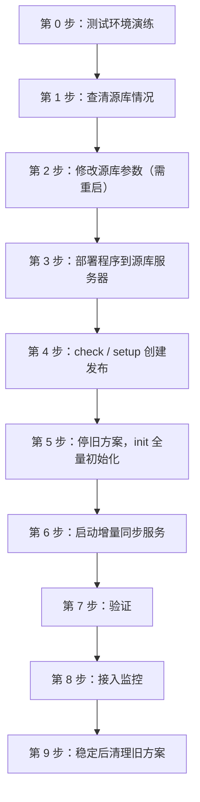

# pglsync 上线部署手册

本文档说明如何从旧的“触发器 + 日志表”同步方案（`cdc_sync.py`）切换到基于 PostgreSQL 逻辑复制的 **pglsync**，以及上线后的日常运维。

方案原理、配置项说明和限制详见 [LOGICAL_SYNC.md](LOGICAL_SYNC.md)。

---

## 总览



| 步骤 | 是否影响业务 | 预计耗时 |
|---|---|---|
| 第 2 步：修改源库参数 | **源库需要重启** | 几分钟 |
| 第 5 步：init 全量初始化 | **目标库这 14 张表在复制期间被锁住** | 取决于两张超表的数据量 |
| 其他步骤 | 无影响 | — |

---

## 第 0 步：在测试环境完整演练（强烈建议）

准备一对测试库，源库的 PostgreSQL / TimescaleDB 版本最好和生产一致，然后把第 1～7 步完整走一遍。重点验证：

- [ ] `init` 能正常完成，`reconcile` 显示全部一致；
- [ ] 在源库上 INSERT、UPDATE、DELETE、**修改主键**、TRUNCATE，目标库都能正确跟上；
- [ ] 停掉同步进程，期间继续写源库，再启动后数据能补齐；
- [ ] 超表启用了压缩的话：手动压缩或解压一个 chunk 后，`reconcile` 仍然一致；
- [ ] 往超表写入一个新时间段的数据（会自动创建新 chunk），目标库能同步到。

---

## 第 1 步：查清源库情况

在源库执行：

```sql
SELECT version();
SELECT extversion FROM pg_extension WHERE extname = 'timescaledb';
SHOW wal_level;
SHOW max_replication_slots;
SHOW max_wal_senders;
SHOW max_slot_wal_keep_size;   -- PG13+
```

根据结果确认：

| 检查项 | 要求 |
|---|---|
| PostgreSQL 版本 | 10 及以上；用了 TimescaleDB 的话**推荐 15 及以上**（可以只发布 chunk 所在的 schema） |
| PG14 及以下 + TimescaleDB | 只能用 `FOR ALL TABLES` 发布全库，要求**库内所有表都有主键**，解码开销也更大 |
| `wal_level` | 必须是 `logical`（见第 2 步） |

---

## 第 2 步：修改源库参数（需要停机窗口）

> [!IMPORTANT]
> 修改 `wal_level` 必须**重启 PostgreSQL**，请安排在维护窗口进行。

```sql
ALTER SYSTEM SET wal_level = 'logical';
ALTER SYSTEM SET max_replication_slots = 10;       -- 原来已经 >= 10 可跳过
ALTER SYSTEM SET max_wal_senders = 10;             -- 原来已经 >= 10 可跳过
ALTER SYSTEM SET max_slot_wal_keep_size = '50GB';  -- PG13+，按磁盘剩余空间设置
```

`max_slot_wal_keep_size` 是兜底保护：同步进程长时间停止时，复制槽最多只保留这么多 WAL，不会把源库磁盘撑满。代价是超出后复制槽失效，需要重新全量初始化。

重启后确认：

```sql
SHOW wal_level;   -- 应为 logical
```

**权限要求**：同步用户必须是超级用户或拥有 `REPLICATION` 权限。逻辑复制连接按**数据库名**匹配 `pg_hba.conf`，现有允许本机连接 `typhoon` 库的规则就够用，不需要额外添加 `replication` 规则。

---

## 第 3 步：部署程序到源库服务器

程序部署在**源库服务器**上，只需要“源库服务器 → 目标库”方向的网络，和现有 `cdc_sync.py` 一样。

### 3.1 获取代码并安装依赖

```bash
mkdir -p /data/pglsync && cd /data/pglsync
git clone -b feature/logical-replication-sync <仓库地址> app
# 也可以直接把 pglsync/ 目录和 requirements.txt 拷贝到 /data/pglsync/app

pip3 install -r app/requirements.txt
```

服务器不能上网时，在能上网、且 Python 版本和 CPU 架构相同的机器上下载离线包：

```bash
pip3 download psycopg2-binary -d ./wheels
# 拷贝到服务器后执行：
pip3 install --no-index --find-links ./wheels psycopg2-binary
```

要求 Python 3.6 及以上。

### 3.2 准备配置文件

```bash
cp app/config.example.json /data/pglsync/config.json
vi /data/pglsync/config.json
```

需要核对的内容：

- `source` / `target` 的地址、端口、库名、用户；
- `tables` 中的 14 张表；
- 两张超表 `tcrealtime`、`tcensemblerealtime` 的 `pk` 是否为 `["id", "datatime"]`；
- `logging.file` 的日志路径。

### 3.3 准备密码文件

密码不写进配置文件，而是放在单独的环境文件中，并限制访问权限：

```bash
cat > /data/pglsync/pglsync.env <<'EOF'
PGLSYNC_SOURCE_PASSWORD=源库密码
PGLSYNC_TARGET_PASSWORD=目标库密码
EOF
chmod 600 /data/pglsync/pglsync.env
```

后面手动执行命令前，先加载环境变量并进入程序目录：

```bash
set -a; source /data/pglsync/pglsync.env; set +a
cd /data/pglsync/app
```

> [!CAUTION]
> 旧脚本 `cdc_sync.py` 和 `compare_tables.py` 中的数据库密码是明文写在代码里的，建议上线后更换这两个账号的密码，并且不要把这些脚本提交到代码仓库。

---

## 第 4 步：检查并创建发布

### 4.1 只读检查

```bash
python3 -m pglsync -c /data/pglsync/config.json check
```

输出分两类：

- **“问题（必须解决）”**：必须处理完才能继续。最常见的是有些表没有主键（复制标识），这些表加入发布后，源库对它们的 UPDATE/DELETE 会直接报错。
  - 推荐做法：为这些表添加主键；
  - 不方便加主键的：在下一步加 `--fix-replica-identity`（设置为 `REPLICA IDENTITY FULL`，会多写一些 WAL）。
- **“警告”**：重点关注超表的**压缩**和**数据保留策略**：
  - 配置了保留策略的超表：目标库要配置**相同的保留策略**，因为整块删除旧数据不会同步过去；
  - 启用了压缩的超表：确认第 0 步的压缩测试已经通过。

### 4.2 创建发布

```bash
python3 -m pglsync -c /data/pglsync/config.json setup
# 需要修复复制标识时：
python3 -m pglsync -c /data/pglsync/config.json setup --fix-replica-identity
```

---

## 第 5 步：停掉旧方案，执行全量初始化

### 5.1 停掉旧的 cdc_sync.py

```bash
ps -ef | grep cdc_sync
kill <pid>
# 如果是 systemd 服务或 crontab 启动的，同时停用对应的服务或定时任务，防止被重新拉起
```

此时**先不要删除**旧的触发器和 `cdc.event_log`，回退时还要用。

### 5.2 全量初始化

```bash
python3 -m pglsync -c /data/pglsync/config.json init
```

程序会列出将被 TRUNCATE 的表，输入 `yes` 确认。

> [!WARNING]
> `init` 会在**一个事务里**对目标库的 14 张表先 TRUNCATE 再整表复制。复制期间这些表被锁住，查询目标库的业务会一直等待，直到复制完成。请选在低峰期执行。
>
> 好处是：现在目标库里已经对不上的数据，会被这次基于一致性快照的全量复制全部修正。

成功时会看到：

```
已创建复制槽 typhoon_sync_slot，一致性位点 xx/xxxxxxx ...
已复制 public.base_authorization_info      ... 行
...
全量复制完成，耗时 xx.xs，同步位点已设为 xx/xxxxxxx
初始化完成。
```

如果中途失败，程序会自动删除刚创建的复制槽，目标库事务也会回滚，表数据保持原样。解决问题后重新执行 `init` 即可。

---

## 第 6 步：启动增量同步服务

```bash
sudo cp /data/pglsync/app/deploy/pglsync.service /etc/systemd/system/
sudo vi /etc/systemd/system/pglsync.service
```

核对服务文件中的以下内容：

- `User`：运行用户；
- `WorkingDirectory`：程序目录 `/data/pglsync/app`；
- `EnvironmentFile`：密码文件 `/data/pglsync/pglsync.env`；
- `ExecStart`：用 `which python3` 确认解释器路径。

然后启动：

```bash
sudo systemctl daemon-reload
sudo systemctl enable --now pglsync

sudo systemctl status pglsync
journalctl -u pglsync -f            # 或 tail -f /data/pglsync/pglsync.log
```

日志中出现 `开始增量同步: slot=... 起始位点=...` 即表示启动成功，之后每 60 秒会输出一条统计：

```
统计: 事务 12, 变更 340, 跳过重放事务 0, 目标缺行 0, 确认位点 xx/xxxxxxx, 最近事务延迟 0.3s
```

---

## 第 7 步：验证

```bash
# 复制槽状态：应显示“是否活跃: 是”，落后量接近 0
python3 -m pglsync -c /data/pglsync/config.json status

# 数据核对：应全部显示“一致”
python3 -m pglsync -c /data/pglsync/config.json reconcile
```

再做一次实时验证：在源库修改一条字典表数据，几秒钟内去目标库确认有没有变化。

`reconcile` 常用参数：

| 参数 | 说明 |
|---|---|
| `--since 2026-10-01` | 超表只核对该时间之后的数据，速度更快 |
| `-t public.tcrealtime` | 只核对指定表，可以多次指定 |
| `--detail` | 列出不一致的具体主键（缺少 / 多出 / 内容不同） |
| `--recheck-delay 30` | 发现不一致时，等 30 秒再复查一次，排除同步延迟造成的短暂差异 |

---

## 第 8 步：接入监控

### 8.1 复制槽健康检查（每 5 分钟）

复制槽没有进程连接、WAL 已失效或缺少同步位点时，`status` 会返回非 0 退出码，可以直接用来告警：

```bash
crontab -e
```

```bash
*/5 * * * * set -a; . /data/pglsync/pglsync.env; set +a; cd /data/pglsync/app && python3 -m pglsync -c /data/pglsync/config.json status > /dev/null 2>&1 || <你的告警命令>
```

### 8.2 每日数据核对

```bash
30 3 * * * set -a; . /data/pglsync/pglsync.env; set +a; cd /data/pglsync/app && python3 -m pglsync -c /data/pglsync/config.json reconcile --since "$(date -d '7 days ago' +\%F)" >> /data/pglsync/reconcile.log 2>&1 || <你的告警命令>
```

`reconcile` 在有不一致时返回退出码 2。

### 8.3 源库侧监控（可选，SQL）

```sql
SELECT slot_name, active,
       pg_size_pretty(pg_wal_lsn_diff(pg_current_wal_lsn(), restart_lsn)) AS retained_wal,
       wal_status
FROM pg_replication_slots
WHERE slot_name = 'typhoon_sync_slot';
```

建议在 `active = false`、或者 `retained_wal` 超过磁盘容量的一定比例时告警。

---

## 第 9 步：稳定运行 1～2 周后，清理旧方案

确认 `reconcile` 一直显示一致后：

1. 删除源库上旧的 CDC 触发器和触发器函数，这样能减少每次业务写入的额外开销；
2. 删除 `cdc.event_log` 表（需要的话可以先备份）；
3. 删除旧脚本 `cdc_sync.py` 的部署文件、`.cdc_last_id` 进度文件和相关定时任务。

---

## 回退方案

如果新方案上线后出现问题，需要退回旧方案：

```bash
sudo systemctl disable --now pglsync
python3 -m pglsync -c /data/pglsync/config.json drop      # 删除复制槽和发布，必须执行
# 然后重新启动旧的 cdc_sync.py
```

> [!NOTE]
> 退回后，旧方案本身“长事务晚提交会丢数据”的问题依然存在。

---

## 日常运维须知

| 场景 | 怎么做 |
|---|---|
| **源表要加列或改结构** | **先改目标库，再改源库**。顺序反了，同步会报错并不断重试，但不会丢数据，补上目标库的列后会自动恢复 |
| 新增一张需要同步的表 | ① 目标库建表；② 把表加进 `config.json` 的 `tables`；③ 执行 `setup`，它会把新表加入发布；④ 执行 `init --recreate-slot` 重新全量初始化，或者手动补齐这张表的历史数据后重启服务 |
| 重启服务器或同步服务 | 直接重启即可，程序会从目标库中保存的位点继续，不丢不重 |
| 同步停了很久，`status` 显示 `wal_status = lost` | 复制槽已失效，执行 `init --recreate-slot` 重新全量初始化 |
| 日志中出现“目标缺行” | 说明目标库和源库已经不一致（比如有人直接改了目标库），用 `reconcile --detail` 定位 |
| 有人直接修改了目标库 | 不允许这样做。目标库只能由 pglsync 写入 |
| **不再需要这套同步** | **必须执行 `drop`**，否则源库会一直保留 WAL，直到磁盘写满 |

### 常用命令速查

```bash
set -a; source /data/pglsync/pglsync.env; set +a
cd /data/pglsync/app
C=/data/pglsync/config.json

python3 -m pglsync -c $C check                    # 只读检查源库条件
python3 -m pglsync -c $C setup                    # 创建或更新发布
python3 -m pglsync -c $C init                     # 首次全量初始化
python3 -m pglsync -c $C init --recreate-slot     # 重新全量初始化
python3 -m pglsync -c $C run                      # 前台运行增量同步（调试用，正式运行请用 systemd）
python3 -m pglsync -c $C -v run                   # 前台运行并输出 DEBUG 日志
python3 -m pglsync -c $C status                   # 查看复制槽和同步位点
python3 -m pglsync -c $C reconcile --detail       # 数据核对
python3 -m pglsync -c $C drop                     # 停用并清理复制槽和发布

sudo systemctl status|restart|stop pglsync        # 服务管理
journalctl -u pglsync -f                          # 查看服务日志
```
