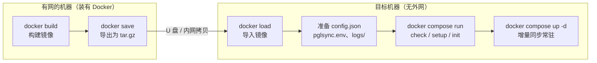

# Docker 部署

用 Docker 部署 pglsync，可以**彻底避开目标机器上的 Python 版本问题**（比如只有 Python 2.7）：镜像里自带 Python 3.11 和所有依赖。目标机器只需要装有 Docker，没有外网也可以，通过 `docker save` / `docker load` 传递镜像。

Python 版和 Java 版都提供了镜像，任选其一。

> 涉及的文件：
> - Python 版：[Dockerfile](../Dockerfile)、[deploy/docker/docker-compose.yml](../deploy/docker/docker-compose.yml)、[deploy/docker/build_and_save.sh](../deploy/docker/build_and_save.sh)
> - Java 版：[pglsync-java/Dockerfile](../pglsync-java/Dockerfile)、[pglsync-java/docker-compose.yml](../pglsync-java/docker-compose.yml)

---

## 1. 整体流程



前提条件：

| 项目 | 要求 |
|---|---|
| 目标机器的 Docker | 已安装（没有的话见 [第 8 节](#8-目标机器没有-docker离线安装)） |
| docker compose | 推荐 v2（`docker compose`）；旧版 v1（`docker-compose`）也可以，见 [第 5.3 节](#53-没有-docker-compose直接用-docker-run) |
| 源库 / 目标库的配置 | 和直接部署时完全一样，见 [USER_GUIDE.md 第 2 节](USER_GUIDE.md#2-数据库配置) |

---

## 2. 网络：为什么用 `network_mode: host`

compose 文件里默认使用**宿主机网络**（`network_mode: host`）：

- 容器里的 `127.0.0.1` 就是宿主机。生产环境中 pglsync 部署在源库服务器上，用 `127.0.0.1:5000` 连接源库，用 Docker 部署后**配置不用改**；
- 源库的 `pg_hba.conf` 不需要为 Docker 网段额外放行；
- 连接目标库（如 `10.0.71.41`）和宿主机直接访问一样。

如果因为安全要求必须使用默认的 bridge 网络，需要注意三点：

1. 配置中的 `127.0.0.1` 要改成宿主机 IP（或 `host.docker.internal`，需要配合 `extra_hosts: ["host.docker.internal:host-gateway"]`）；
2. 源库的 `listen_addresses` 要包含该 IP；
3. 源库的 `pg_hba.conf` 要放行 Docker 网段（默认 `172.17.0.0/16`）。

---

## 3. 在有网的机器上构建并导出镜像

### 3.1 用脚本（推荐）

```bash
cd cdc-pgtables-sync

bash deploy/docker/build_and_save.sh python                 # Python 版，x86_64
bash deploy/docker/build_and_save.sh python linux/arm64     # Python 版，ARM 服务器（鲲鹏/飞腾）
bash deploy/docker/build_and_save.sh java                   # Java 版
```

产物在 `dist/docker/` 目录：

- `pglsync-1.0.0-amd64.tar.gz`：镜像；
- `docker-compose.yml`、`pglsync.env.example`、`config.example.json`、`config.test.json`：部署用的文件。

**目标机器的 CPU 架构必须和镜像一致**（在目标机器上用 `uname -m` 查看：`x86_64` 对应 `linux/amd64`，`aarch64` 对应 `linux/arm64`）。否则启动时会报 `exec format error`。

### 3.2 手动构建

```bash
docker build -t pglsync:1.0.0 .                                   # Python 版（仓库根目录）
docker build -t pglsync-java:1.0.0 pglsync-java                   # Java 版
docker buildx build --platform linux/arm64 -t pglsync:1.0.0 --load .   # 跨架构构建

docker save pglsync:1.0.0 | gzip > pglsync-1.0.0-amd64.tar.gz
```

镜像说明：

- 基础镜像是 `python:3.11-slim`，约 150MB；
- 构建时会**跑一遍单元测试**，测试不通过就构建失败；
- 以非 root 用户（uid 10001）运行；
- 旧脚本（`cdc_sync.py` 等，里面有明文密码）、`config.json`、`*.env` 已在 `.dockerignore` 中排除，**不会打进镜像**。

### 3.3 构建时拉不到基础镜像

典型报错：

```
ERROR: failed to solve: python:3.11-slim: failed to resolve source metadata for
docker.io/library/python:3.11-slim: docker.io/library/python:3.11-slim: not found
```

**它的意思是构建过程没能从 Docker Hub 取到基础镜像，并不是镜像真的不存在。** 先在构建机上执行下面两条命令定位原因：

```bash
docker pull python:3.11-slim          # 1. docker 守护进程能不能拉到
docker buildx ls                      # 2. 当前使用的是哪个 builder（带 * 的那一行）
```

| `docker pull` 的结果 | 原因 | 处理 |
|---|---|---|
| **成功** | buildx 当前使用的是独立的 builder（DRIVER 列为 `docker-container`）。它运行在单独的容器里，**不会使用** `/etc/docker/daemon.json` 中配置的镜像加速，也看不到本地已有的镜像 | ① 改用默认 builder：`docker buildx use default`；② 或者直接用 `docker build`（新版脚本在本机架构下会自动这样做）；③ 必须跨架构构建时，给 builder 配置镜像加速，见下文 |
| **失败**（超时、`not found`、`unauthorized`） | 构建机访问不了 Docker Hub（国内网络常见），或者配置的加速地址已经失效 | 配置可用的镜像加速，或者通过 `BASE_IMAGE` 改用内网 Harbor / 国内镜像站，见下文 |

**处理方法 1：配置 Docker 镜像加速**（对 `docker pull` / `docker build` 生效）

```bash
sudo tee /etc/docker/daemon.json <<'EOF'
{
  "registry-mirrors": ["https://<你的镜像加速地址>"]
}
EOF
sudo systemctl daemon-reload && sudo systemctl restart docker
docker info | grep -A3 "Registry Mirrors"       # 确认已生效
```

加速地址可以用公司内网的 Harbor 或 Nexus 代理，也可以用云厂商（如阿里云容器镜像服务）给账号分配的专属加速地址。公共加速站的可用性经常变化，失效时请换一个。

**处理方法 2：直接指定基础镜像地址**（不依赖加速配置）

新版脚本和 Dockerfile 支持用环境变量或构建参数替换基础镜像，同时也可以替换 pip / Maven 源：

```bash
# Python 版：基础镜像从内网 Harbor 或国内镜像站拉取，pip 使用清华源
BASE_IMAGE=harbor.example.com/library/python:3.11-slim \
PIP_INDEX_URL=https://pypi.tuna.tsinghua.edu.cn/simple \
bash deploy/docker/build_and_save.sh python

# Java 版
BUILD_IMAGE=harbor.example.com/library/maven:3.9-eclipse-temurin-8 \
RUNTIME_IMAGE=harbor.example.com/library/eclipse-temurin:8-jre \
MAVEN_MIRROR_URL=https://maven.aliyun.com/repository/public \
bash deploy/docker/build_and_save.sh java
```

手动构建时写法相同：`docker build --build-arg BASE_IMAGE=... --build-arg PIP_INDEX_URL=... -t pglsync:1.0.0 .`

**处理方法 3：别处拉好镜像，导入构建机**

能访问 Docker Hub 的任意机器上执行 `docker pull python:3.11-slim && docker save python:3.11-slim -o python-3.11-slim.tar`，拷到构建机上 `docker load -i python-3.11-slim.tar`。之后在本机架构下用 `docker build` 构建，会直接使用这个本地镜像。

**跨架构构建（buildx）时给 builder 配置镜像加速：**

```bash
cat > buildkitd.toml <<'EOF'
[registry."docker.io"]
  mirrors = ["<你的镜像加速地址，不带 https://>"]
EOF
docker buildx create --name pglsync-builder --driver docker-container --config buildkitd.toml --use
docker buildx inspect --bootstrap
```

新版 [build_and_save.sh](../deploy/docker/build_and_save.sh) 的改进：

- 先用 `docker pull` 拉取基础镜像，拉不到时直接给出上面这些处理建议；
- 目标架构与本机相同时，用普通的 `docker build`，会使用 daemon 的加速配置和本地镜像；只有跨架构时才用 buildx。

---

## 4. 在目标机器上导入镜像并准备目录

```bash
# 1. 导入镜像
docker load -i pglsync-1.0.0-amd64.tar.gz
docker images | grep pglsync

# 2. 准备部署目录
sudo mkdir -p /opt/pglsync-docker && cd /opt/pglsync-docker
cp /path/to/dist/docker/docker-compose.yml .
cp /path/to/dist/docker/config.example.json config.json       # 按实际环境修改
cp /path/to/dist/docker/pglsync.env.example pglsync.env       # 填写密码
chmod 600 pglsync.env

# 3. 日志目录：容器以 uid 10001 运行，需要有写权限
mkdir -p logs && sudo chown 10001:10001 logs
```

修改 `config.json` 时注意三点：

- 连接信息和直接部署时一样（用了宿主机网络，`127.0.0.1` 依然有效）；
- 密码用 `"password_env": "PGLSYNC_SOURCE_PASSWORD"` 引用 `pglsync.env` 里的变量；测试环境也可以直接写 `"password"`；
- 日志路径写 `"file": "/app/logs/pglsync.log"`，或者相对路径 `"logs/pglsync.log"`（容器的工作目录是 `/app`）。日志会写到宿主机的 `/opt/pglsync-docker/logs/` 下。

最终的目录结构：

```
/opt/pglsync-docker/
├── docker-compose.yml
├── config.json
├── pglsync.env          (chmod 600)
└── logs/                (属主 10001)
```

---

## 5. 运行

以下命令都在 `/opt/pglsync-docker` 目录下执行。

### 5.1 首次启动

```bash
# 一次性命令：docker compose run --rm pglsync <命令> [参数]
docker compose run --rm pglsync check
docker compose run --rm pglsync setup
docker compose run --rm pglsync init --no-copy      # 已有一致数据；会交互确认，输入 yes
docker compose run --rm pglsync init -y             # 或者：全量初始化，不交互

# 启动增量同步（后台常驻，异常退出或宿主机重启后会自动拉起）
docker compose up -d pglsync
docker compose logs -f pglsync
```

`docker compose run` 默认分配终端，所以 `init` 时可以直接输入 `yes`。如果是在脚本里执行，加 `-y` 跳过确认。

### 5.2 日常运维

| 操作 | 命令 |
|---|---|
| 查看日志 | `docker compose logs -f --tail=200 pglsync`，或者 `tail -f logs/pglsync.log` |
| 查看状态 | `docker compose run --rm pglsync status` |
| 健康状态 | `docker ps`：STATUS 列显示 `healthy` / `unhealthy`（每 2 分钟执行一次 `status`） |
| 数据核对 | `docker compose run --rm pglsync reconcile --since 2026-11-01` |
| 停止 / 启动 / 重启 | `docker compose stop pglsync` / `start` / `restart`（停止时会处理完当前事务、提交位点再退出，最多等待 120 秒） |
| 单表重新复制 | `docker compose stop pglsync` → `docker compose run --rm pglsync resync -t public.new_table` → `docker compose start pglsync` |
| 修改配置后生效 | `docker compose restart pglsync` |
| 停用同步 | `docker compose down`，然后 `docker compose run --rm pglsync drop -y`（**必须执行 drop**，否则源库会一直保留 WAL） |

新增同步表、修改表结构的完整步骤见 [USER_GUIDE.md 第 8 节](USER_GUIDE.md#8-新增同步表与表结构变更)。把 `python3 -m pglsync -c config.json` 换成 `docker compose run --rm pglsync` 即可。

### 5.3 没有 docker compose：直接用 docker run

```bash
# 一次性命令
docker run --rm -it --network host --env-file pglsync.env \
  -v $PWD/config.json:/app/config/config.json:ro -v $PWD/logs:/app/logs \
  pglsync:1.0.0 check

# 常驻增量同步
docker run -d --name pglsync --restart unless-stopped --stop-timeout 120 \
  --network host --env-file pglsync.env \
  -v $PWD/config.json:/app/config/config.json:ro -v $PWD/logs:/app/logs \
  --log-opt max-size=50m --log-opt max-file=5 \
  pglsync:1.0.0 run

docker logs -f pglsync
docker stop -t 120 pglsync
```

### 5.4 测试写入（测试环境）

```bash
# 常驻：每 5 分钟一轮，两张超表各写约 1 万行
docker compose --profile test up -d load-writer
docker compose logs -f load-writer

# 只写一轮
docker compose run --rm --entrypoint python pglsync tools/load_writer.py -c /app/config/config.json --once --rows 100

# 停止
docker compose --profile test stop load-writer
```

`profiles` 需要 docker compose 1.28 及以上；版本更旧时，用 5.3 节的 `docker run` 方式，加上 `--entrypoint python ... tools/load_writer.py -c /app/config/config.json`。

---

## 6. 升级

```bash
# 有网的机器：拉取最新代码，重新构建并导出
bash deploy/docker/build_and_save.sh python

# 目标机器：导入新镜像并重建容器
docker load -i pglsync-1.0.0-amd64.tar.gz
docker compose up -d pglsync        # 镜像有变化时会自动重建容器
```

同步位点保存在**目标库**的 `pglsync.sync_state` 表中，不在容器里，所以重建容器不影响断点续传。版本号变了的话，同时修改 `docker-compose.yml` 中的 `image:` 标签。

---

## 7. Java 版

> Java 版代码和镜像文件只在 `feature/java-springboot` 分支上。

Java 版的步骤和 Python 版相同，区别只在于镜像和配置文件：

```bash
# 有网的机器
bash deploy/docker/build_and_save.sh java     # 构建 pglsync-java:1.0.0（多阶段构建，运行阶段只有 JRE 8）

# 目标机器
docker load -i pglsync-java-1.0.0-amd64.tar.gz
cd /opt/pglsync-docker
#   docker-compose-java.yml   compose 文件
#   application.yml           外部配置（覆盖镜像内置默认值），密码用 ${PGLSYNC_SOURCE_PASSWORD:} 引用
#   pglsync.env、logs/        同 Python 版
docker compose -f docker-compose-java.yml run --rm pglsync-java check
docker compose -f docker-compose-java.yml run --rm pglsync-java init --no-copy --yes
docker compose -f docker-compose-java.yml up -d pglsync-java
```

Java 版的选项写法是 `--名称=值`，例如 `resync --table=public.new_table`、`reconcile --since=2026-11-01`。

---

## 8. 目标机器没有 Docker：离线安装

使用 Docker 官方的静态二进制包，不依赖 yum/apt 源。

```bash
# 有网的机器：从下面的地址下载（x86_64 换成 aarch64 即为 ARM 版）
#   https://download.docker.com/linux/static/stable/x86_64/docker-24.0.9.tgz
#   docker compose 插件：https://github.com/docker/compose/releases （docker-compose-linux-x86_64）

# 目标机器
tar xzf docker-24.0.9.tgz
sudo cp docker/* /usr/bin/
sudo mkdir -p /usr/local/lib/docker/cli-plugins
sudo cp docker-compose-linux-x86_64 /usr/local/lib/docker/cli-plugins/docker-compose
sudo chmod +x /usr/local/lib/docker/cli-plugins/docker-compose
```

创建 systemd 服务 `/etc/systemd/system/docker.service`：

```ini
[Unit]
Description=Docker Engine
After=network-online.target
Wants=network-online.target

[Service]
Type=notify
ExecStart=/usr/bin/dockerd
ExecReload=/bin/kill -s HUP $MAINPID
Restart=always
LimitNOFILE=infinity
LimitNPROC=infinity
Delegate=yes
KillMode=process

[Install]
WantedBy=multi-user.target
```

```bash
sudo systemctl daemon-reload && sudo systemctl enable --now docker
docker version && docker compose version
```

> [!NOTE]
> CentOS 7 的内核是 3.10，可以运行 Docker（`overlay2` 存储驱动要求内核 3.10.0-514 及以上，即 CentOS 7.3+）。如果服务器有安全基线要求，安装前请先和运维确认。

---

## 9. 常见问题

| 现象 | 原因 | 处理 |
|---|---|---|
| 构建时报 `failed to resolve source metadata for docker.io/library/python:3.11-slim ... not found` | 构建机访问不了 Docker Hub，或者 buildx 的独立 builder 没有使用镜像加速 | 见 [第 3.3 节](#33-构建时拉不到基础镜像) |
| `exec format error` | 镜像架构与目标机器不一致 | 按 `uname -m` 重新构建：`build_and_save.sh python linux/arm64` |
| `connection refused` 连接 127.0.0.1 | 没有使用宿主机网络 | 确认 compose 中有 `network_mode: host`，`docker run` 时加 `--network host` |
| `no pg_hba.conf entry for host "172.17.x.x"` | 使用了 bridge 网络 | 改用宿主机网络，或者在 `pg_hba.conf` 中放行 Docker 网段 |
| `PermissionError: ... /app/logs/...` | 日志目录没有写权限 | `sudo chown 10001:10001 logs` |
| `init` 时报 `EOFError` | 没有终端，无法交互确认 | 加 `-y`（Java 版加 `--yes`），或者 `docker run` 加 `-it` |
| `配置文件不存在: /app/config/config.json` | 没有挂载配置，或者路径写错了 | 检查 `-v $PWD/config.json:/app/config/config.json:ro`，宿主机上的文件必须存在 |
| 日志时间差 8 小时 | 时区不对 | compose 中已经设置了 `TZ=Asia/Shanghai`；`docker run` 时加 `-e TZ=Asia/Shanghai` |
| 容器 `unhealthy` | `status` 返回非 0（复制槽不活跃、WAL 失效、没有同步位点） | 用 `docker compose logs pglsync` 查看同步日志，用 `docker compose run --rm pglsync status` 查看详情 |
| 停止很慢 | 正在处理一个大事务，会等它处理完再退出 | 属于正常现象，最多等待 120 秒（`stop_grace_period`） |
