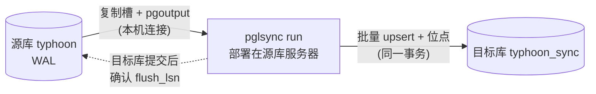

# pglsync：基于 PostgreSQL 逻辑复制的表同步

用来替代基于触发器和日志表的 `cdc_sync.py`。程序直接读取源库 WAL 的逻辑解码流（PostgreSQL 内置的 `pgoutput` 插件），把指定表的变更按**提交顺序**应用到目标库。

## 1. 为什么替换旧方案

| 问题 | 旧方案 cdc_sync.py | pglsync |
|---|---|---|
| 长事务晚提交 | 进度只记最大 `event_id`，晚提交的小 id 被永久跳过 | WAL 天然按提交顺序发送，不会跳号 |
| 全量和增量的衔接 | 全量复制与增量起点不在同一时间点 | 复制槽导出一致性快照，全量复制恰好截止在增量起点 |
| 进度可靠性 | 进度存在本地文件，与目标库写入不是同一个原子操作 | 位点与数据在目标库**同一事务**提交；目标库提交后才向源库确认 |
| 写入幂等 | `INSERT ... DO NOTHING`；UPDATE 影响 0 行时不报错 | 统一 `INSERT ... ON CONFLICT DO UPDATE`；整行 UPDATE 遇到目标缺行会自动补上 |
| 修改主键 | 丢失 | 先删除旧主键对应的行，再写入新行 |
| TRUNCATE | 捕获不到 | 能捕获 |
| 超表 chunk 映射失败 | 静默跳过，进度照样推进 | 查询失败就重连重试，不会跳过 |
| 数据类型 | 经过 JSON 往返，数组、numeric 等类型有风险 | 使用 PostgreSQL 文本格式，由目标库按列类型解析，不丢精度 |
| 源库开销 | 每张表一个触发器，额外写一份日志表 | 不需要触发器 |

## 2. 架构



网络只需要“源库服务器 → 目标库”方向，与现有部署方式相同。

## 3. 前置条件

1. **PostgreSQL 10 及以上**。如果用了 TimescaleDB，推荐 **PG15 及以上**（原因见第 6 节）。
2. 修改源库参数。前两项改完需要**重启** PostgreSQL：
   ```sql
   ALTER SYSTEM SET wal_level = 'logical';            -- 需要重启
   ALTER SYSTEM SET max_replication_slots = 10;       -- 需要重启（已经 >= 10 可跳过）
   ALTER SYSTEM SET max_wal_senders = 10;             -- 需要重启（已经 >= 10 可跳过）
   ALTER SYSTEM SET max_slot_wal_keep_size = '50GB';  -- PG13+，按磁盘容量设置，防止 WAL 撑满磁盘
   ```
3. 同步用户需要是超级用户或拥有 `REPLICATION` 权限。逻辑复制连接按**数据库名**匹配 `pg_hba.conf`，现有允许本机连接 `typhoon` 的规则就够用。
4. 目标库预先建好同名同结构的表，例如：
   `pg_dump -s -t 'public.base_*' -t public.tcrealtime ... typhoon | psql typhoon_sync`
   如果目标表也是超表，需要在目标库执行 `create_hypertable`。
5. 运行环境：Python 3.6 及以上，`pip install -r requirements.txt`。

## 4. 使用步骤

> 完整的上线步骤（含停机窗口、迁移切换、监控、回退方案）请见 [DEPLOYMENT_GUIDE.md](DEPLOYMENT_GUIDE.md)。

```bash
cp config.example.json /data/pglsync/config.json      # 按实际情况修改
export PGLSYNC_SOURCE_PASSWORD='***'                  # 密码不要写进配置文件
export PGLSYNC_TARGET_PASSWORD='***'

python3 -m pglsync -c /data/pglsync/config.json check   # 1. 只读检查
python3 -m pglsync -c /data/pglsync/config.json setup   # 2. 创建发布
python3 -m pglsync -c /data/pglsync/config.json init    # 3. 创建复制槽 + 一致性全量复制（会 TRUNCATE 目标表）
python3 -m pglsync -c /data/pglsync/config.json run     # 4. 增量同步（建议用 systemd 托管）
```

建议用 systemd 托管 `run`，参考 [deploy/pglsync.service](deploy/pglsync.service)：

```bash
sudo cp deploy/pglsync.service /etc/systemd/system/
sudo systemctl daemon-reload && sudo systemctl enable --now pglsync
```

### 从旧方案切换

1. 停止 `cdc_sync.py`。
2. 依次执行 `check`、`setup`、`init`、`run`。`init` 会按一致性快照重新全量复制，旧方案留下的差异会一并修正。
3. 观察一段时间，`reconcile` 确认没有差异后，再删除源库上的旧触发器和 `cdc.event_log`（不再需要，也能省掉写入开销）。

### 日常运维

| 命令 | 用途 |
|---|---|
| `status` | 查看复制槽是否有进程连接、积压了多少 WAL、目标库同步位点。**建议接入监控**，进程不活跃或积压过大时告警 |
| `reconcile [--since 2026-10-01] [--detail]` | 比较行数和整行哈希，按时间桶定位差异；`--detail` 列出具体主键 |
| `init --recreate-slot` | 需要从头重新全量同步时使用 |
| `drop` | **停用同步时必须执行**。复制槽如果一直没人消费，源库会一直保留 WAL |

## 5. 配置说明（config.example.json）

| 配置项 | 说明 |
|---|---|
| `source` / `target` | 支持任意 libpq 参数（`sslmode` 等）。密码用 `password_env` 指定从哪个环境变量读取 |
| `slot_name` / `publication` | 复制槽名和发布名 |
| `state_schema` | 目标库中存放同步位点表（`sync_state`）的 schema |
| `publication_mode` | `auto`（默认）：PG15+ 用 `schema`，否则用 `all`；没有 TimescaleDB 时只发布配置的表 |
| `tables` | 需要同步的表。`pk` 不填时取源表主键；`time_column` / `bucket` 用于 reconcile 按时间分桶核对 |
| `apply.batch_max_changes` / `batch_max_seconds` | 多个源事务合并成一个目标事务提交，以提高吞吐 |
| `apply.on_missing_row` | 部分列 UPDATE 找不到目标行时的处理：`warn` 记录警告并继续，`error` 停下等待人工处理 |
| `apply.chunk_truncate` | 源库单独 TRUNCATE 某个 chunk 时的处理：`warn` 忽略并告警，`error` 停止同步 |

## 6. TimescaleDB 注意事项

- 超表的数据实际存放在 chunk 中，而且会自动创建新 chunk。因此发布必须覆盖 `_timescaledb_internal` schema（PG15+ 的 `TABLES IN SCHEMA`），否则新 chunk 的变更捕获不到。程序会把 chunk 上的变更自动映射回超表。
- PG14 及以下只能用 `FOR ALL TABLES`：全库的变更都会被解码，再由客户端过滤。
- **被发布的表如果没有主键或复制标识，源库对它执行 UPDATE/DELETE 会直接报错。** `setup` 在创建发布前会检查覆盖范围内所有表，有问题就拒绝执行。处理办法：为这些表加主键（推荐），或者使用 `--fix-replica-identity`。
- **数据保留策略（drop_chunks）**：整个 chunk 直接被删除，不产生逐行变更，目标库不会跟着删。请在目标库配置相同的保留策略。
- **压缩**：压缩和解压会在 WAL 中产生 chunk 行的删除和重新插入。上线前请在测试环境验证，并定期对已压缩的时间段执行 `reconcile`。`check` 会列出启用了压缩或保留策略的同步超表。

## 7. 其他限制

- **DDL 不会同步**。源表加列时，先在目标库加同样的列，再在源库执行。顺序反了，程序会因为列不匹配而报错并不断重试，但不会丢数据（WAL 会保留在复制槽中）。
- 目标库只应由 pglsync 写入。
- 复制槽会一直保留未确认的 WAL。同步进程长时间停止会占用源库磁盘，务必用 `status` 加上 `max_slot_wal_keep_size` 兜底。

## 8. 测试

```bash
python -m unittest discover -s tests -v
```

单元测试覆盖 pgoutput 解码、幂等写入、主键变更、TOAST 未变更列、TRUNCATE、chunk 映射、重放跳过和位点确认逻辑，不需要数据库。上线前请在测试库中完整走一遍 `setup`、`init`、`run`、`reconcile`。
