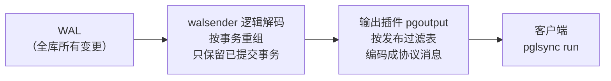
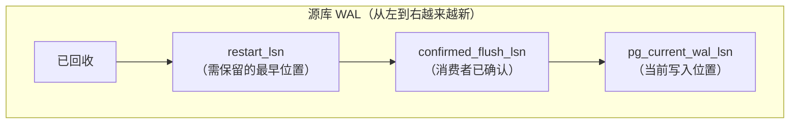
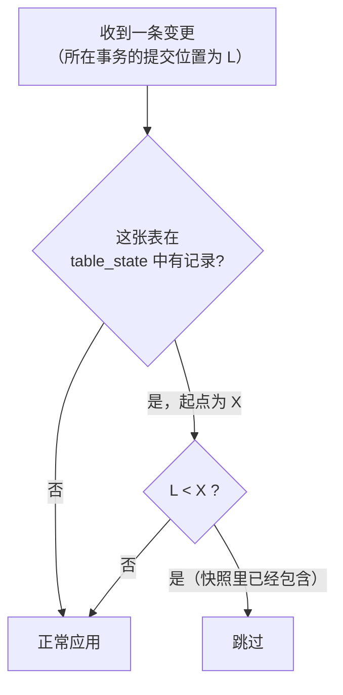

# PostgreSQL 复制槽详解，以及 pglsync 是如何使用它的

本文回答三个问题：

1. **复制槽是什么？** 它记录了什么、会带来什么风险。
2. **pglsync 的 `init`、`init --no-copy`、`resync`、`run` 分别是怎么用复制槽和快照的？**
3. **新增或修改了一张表，要不要把所有表重新同步一遍？**

> **先说结论：不需要。** 新增或修改一张表时，只需要对**这一张表**执行 `resync`。主复制槽**不重建、不改动**，其他表也不受任何影响。
>
> 还有一点需要澄清：快照并**不会被“加到”复制槽上**。复制槽始终只是一条“全库变更流”的书签；“这张表从哪个位置开始同步”记录在**目标库**的 `pglsync.table_state` 表中，由 pglsync 在应用变更时自己判断。详见第 5 节。

---

## 目录

- [1. 基础概念：WAL 与 LSN](#1-基础概念wal-与-lsn)
- [2. 逻辑解码：把 WAL 翻译成行变更](#2-逻辑解码把-wal-翻译成行变更)
- [3. 复制槽](#3-复制槽)
- [4. 发布（publication）：决定要哪些表](#4-发布publication决定要哪些表)
- [5. pglsync 中的复制槽与快照](#5-pglsync-中的复制槽与快照)
- [6. 复制槽的风险与运维](#6-复制槽的风险与运维)
- [7. 常见问题](#7-常见问题)
- [8. 监控与排查 SQL 速查](#8-监控与排查-sql-速查)

---

## 1. 基础概念：WAL 与 LSN

### 1.1 WAL（预写日志）

PostgreSQL 修改数据之前，会先把修改记录写进 **WAL（Write-Ahead Log）**，放在数据目录的 `pg_wal/` 下，每个文件默认 16MB。WAL 有三个用途：

- 崩溃恢复：重启时重放 WAL；
- 物理复制：备库接收并重放 WAL；
- **逻辑复制**：把 WAL 解码成“哪张表、哪一行、改成了什么”。pglsync 用的就是这一种。

正常情况下，旧的 WAL 文件在检查点之后会被回收或复用。但**只要有复制槽还需要它们，就不会被删除**（见第 3 节）。

### 1.2 LSN（日志序列号）

**LSN（Log Sequence Number）**是 WAL 中的字节位置，写成 `4/3213BD08` 这样的形式。它是一个 64 位整数，只增不减。

```sql
SELECT pg_current_wal_lsn();                         -- 当前写到哪了
SELECT pg_wal_lsn_diff('4/35A0C2B8', '4/3213BD08');   -- 两个位置相差多少字节
```

pglsync 日志里的“起始位点”“确认位点”，以及目标库 `sync_state.lsn`，都是 LSN。

---

## 2. 逻辑解码：把 WAL 翻译成行变更

`wal_level = logical` 时，WAL 中会额外记录逻辑解码需要的信息，比如行的主键旧值。**逻辑解码（logical decoding）**由源库上的 **walsender 进程**完成：



几个关键特性：

| 特性 | 说明 | 对 pglsync 的意义 |
|---|---|---|
| **按提交顺序输出** | 事务在**提交时**才整体发送，顺序就是提交顺序 | 不会再出现旧方案“长事务晚提交被跳过”的问题 |
| **只输出已提交事务** | 回滚的事务直接丢弃 | 目标库不会出现“幽灵数据” |
| **全库 WAL 都要读** | 无论发布了几张表，walsender 都要读、解码整个库的 WAL，再按发布过滤 | 解码开销与全库写入量有关；所以一个库通常**只用一个复制槽**，不要每张表建一个 |
| **大事务会写临时文件** | 单个事务超过 `logical_decoding_work_mem`（默认 64MB）就写到 `pg_replslot/` 下 | 大批量导入时注意磁盘 |
| **使用当时的表结构解码** | 解码时用的是 WAL 写入那一刻的系统表快照（historic catalog snapshot） | 表结构变更前的旧变更，按旧结构发送（见 5.4 节） |
| **跳过空事务**（PG15+） | 与发布无关的事务不再发送空的 BEGIN/COMMIT | pglsync 空闲时会主动推进确认位点 |

---

## 3. 复制槽

### 3.1 复制槽是什么

**复制槽（replication slot）是源库上一个持久化的“书签”**。它记住某个消费者读到了 WAL 的什么位置，并且**保证这个位置之后的 WAL 不会被删除**，直到消费者确认处理完。

没有复制槽的话，消费者一旦断开，源库可能已经把它没读的 WAL 删掉了，数据就丢了。有了复制槽，消费者断开再多久，回来都能从断点继续（代价是源库要一直保留 WAL）。



### 3.2 复制槽记录了什么

```sql
SELECT slot_name, plugin, slot_type, database, active, active_pid,
       restart_lsn, confirmed_flush_lsn, catalog_xmin, wal_status
FROM pg_replication_slots;
```

| 字段 | 含义 |
|---|---|
| `slot_name` | 名字。pglsync 测试环境中是 `pglsync_test_slot` |
| `plugin` | 输出插件。pglsync 使用 PostgreSQL 内置的 `pgoutput` |
| `slot_type` | `logical`（逻辑）或 `physical`（物理，给备库用） |
| `database` | **逻辑复制槽只属于一个数据库**，只解码这个库的变更 |
| `active` / `active_pid` | 当前是否有消费者连着、是哪个进程。**同一时刻只能有一个消费者** |
| `confirmed_flush_lsn` | 消费者确认“这之前的数据我已经安全保存了”的位置。下次连接从这里继续 |
| `restart_lsn` | 为了能继续解码，必须保留的最早 WAL 位置。通常比 `confirmed_flush_lsn` 稍早（要能找回当时还没结束的事务的开头）。**这之前的 WAL 才允许回收** |
| `catalog_xmin` | 为了用旧表结构解码，复制槽阻止 VACUUM 清理**系统表**中比它新的旧版本 |
| `wal_status` | PG13 及以上：`reserved`/`extended` 正常；`unreserved` 即将超限；`lost` 已失效 |

### 3.3 复制槽的几个重要性质

1. **持久化**：复制槽保存在 `pg_replslot/` 目录，PostgreSQL 重启后依然存在。不用了必须手动删除（pglsync 的 `drop` 命令）。
2. **只能往前走**：`confirmed_flush_lsn` 只会前进，不能倒退。消费者请求从更早的位置开始时，源库会自动从 `confirmed_flush_lsn` 开始发送。**所以无法“回放”复制槽来补某张表的历史数据**，这也是 `resync` 必须用快照复制数据的原因。
3. **至少发送一次**：如果消费者在确认之前断开，重连后会重新收到确认位置之后的事务，所以可能会**重复收到**。pglsync 的处理方法：位点和数据同事务提交，并跳过 `提交位置 < 已应用位点` 的事务；写入本身也是可以安全重放的。
4. **复制槽不知道“表”**：复制槽只是全库变更流上的一个位置，**不记录**同步哪些表，也**不记录**任何快照。要哪些表由发布决定（第 4 节）。
5. **临时复制槽**：创建时加 `TEMPORARY`，连接断开后自动删除，不会长期保留 WAL。pglsync 的 `resync` 用的就是临时复制槽。
6. **创建时需要等待**：创建逻辑复制槽时，要等源库上**正在执行的事务都结束**，才能确定一个一致的起点。源库如果有长时间不提交的事务，`init`/`resync` 会一直卡在这一步。

### 3.4 创建复制槽时导出快照

复制槽创建时可以同时**导出一个快照**：

```
CREATE_REPLICATION_SLOT pglsync_test_slot LOGICAL pgoutput EXPORT_SNAPSHOT
→ consistent_point = 4/3213BD08，snapshot_name = 00000003-0000001B-1
```

- `consistent_point`（记作 **X**）：复制槽的起点；
- `snapshot_name`：另一个连接执行 `SET TRANSACTION SNAPSHOT '00000003-0000001B-1'` 后，看到的数据**恰好是 X 时刻的状态**：
  - 提交位置在 X 之前的事务，**全部能看到**；
  - 提交位置在 X 及之后的事务，**全部看不到**，这些事务会从复制槽的变更流里发出来。

**所以“用快照复制数据”加上“从 X 开始应用变更”，正好不重不漏。** 这是 pglsync 所有初始化操作的基础。

注意：导出的快照只在**创建它的那个连接保持打开、并且不再执行其他命令**时有效，所以复制数据期间，pglsync 会一直挂着这个连接。

---

## 4. 发布（publication）：决定要哪些表

**发布（publication）是源库上的一个对象，列出“哪些表的变更需要发出去”。** 客户端开始读取复制流时指定发布名（`publication_names`），`pgoutput` 只输出发布中的表。

```sql
SELECT * FROM pg_publication;                                          -- 有哪些发布
SELECT * FROM pg_publication_tables WHERE pubname = 'pglsync_test_pub'; -- 发布里有哪些表
ALTER PUBLICATION pglsync_test_pub ADD TABLE public.new_table;         -- 加表（pglsync setup 会自动执行）
ALTER PUBLICATION pglsync_test_pub DROP TABLE public.old_table;        -- 移除
```

**复制槽和发布是两个独立的对象：**

| | 复制槽 | 发布 |
|---|---|---|
| 是什么 | 全库变更流上的位置（书签） | 表的清单（过滤器） |
| 管什么 | 从哪里继续读、保留多少 WAL | 要哪些表的变更 |
| 新增同步表时 | **不用动** | `ADD TABLE`（执行 `setup`） |

几点补充：

- **发布里加了表，只影响之后的变更**：`ALTER PUBLICATION ... ADD TABLE` 提交之后产生的变更才会发出来，之前的历史数据不会补发。所以新表的已有数据必须单独复制，也就是 `resync`。
- **被发布的表必须有复制标识**：通常就是主键。否则源库对这张表的 UPDATE/DELETE 会直接报错。
- **TimescaleDB 超表**：数据实际在 chunk 里，所以发布要覆盖 `_timescaledb_internal` schema（PG15+），或者用 `FOR ALL TABLES`（PG14 及以下）。pglsync 收到 chunk 的变更后，会映射回超表。

---

## 5. pglsync 中的复制槽与快照

### 5.1 涉及的对象一览

| 对象 | 所在位置 | 数量 | 作用 |
|---|---|---|---|
| 主复制槽 `slot-name` | 源库 | **1 个，长期存在** | 全库变更流的书签，`run` 一直从它读取 |
| 发布 `publication` | 源库 | 1 个 | 过滤出要同步的表 |
| 临时复制槽 `xxx_rs_*` | 源库 | `resync` 期间临时存在 | 只为了拿到一个快照和对应的位置 X，命令结束后自动删除 |
| `pglsync.sync_state` | 目标库 | 每个复制槽一行 | 全局同步位点：最后一个已应用事务的结束位置 |
| `pglsync.table_state` | 目标库 | 每个 resync 过的表一行 | **单表起点**：这张表在 X 之前的变更跳过 |

### 5.2 `init`：创建主复制槽 + 全量复制

```mermaid
sequenceDiagram
    participant P as pglsync init
    participant S as 源库
    participant T as 目标库
    P->>S: CREATE_REPLICATION_SLOT 主槽 EXPORT_SNAPSHOT
    S-->>P: 位置 X + 快照名
    P->>S: 另一连接 SET TRANSACTION SNAPSHOT（看到 X 时刻的数据）
    P->>T: BEGIN; TRUNCATE 所有表
    S-->>T: COPY 所有表（快照数据）
    P->>T: sync_state = X; COMMIT
    Note over P,T: 之后 run 从 X 开始读主槽
```

### 5.3 `init --no-copy`：创建主复制槽 + 核对现有数据

和 `init` 一样创建主复制槽并拿到快照，只是**不复制，改为核对**：用快照读取源库，和目标库逐表比较行数和整行哈希。

- 一致：直接把 `sync_state` 设为 X；
- 不一致：放弃（默认），或者只复制不一致的表（`--on-mismatch copy`）。

### 5.4 `resync`：主复制槽不动，只给某几张表重新建立起点

这就是**新增表、修改表结构时用的命令**。

```mermaid
sequenceDiagram
    participant R as pglsync resync
    participant S as 源库
    participant T as 目标库
    Note over S: 主复制槽停在 P（run 已停止，WAL 从 P 开始保留）
    R->>S: CREATE_REPLICATION_SLOT 临时槽 TEMPORARY EXPORT_SNAPSHOT
    S-->>R: 位置 X（X > P）+ 快照名
    R->>T: BEGIN; TRUNCATE 新表
    S-->>T: COPY 新表（X 时刻的数据）
    R->>T: table_state(新表) = X; COMMIT
    R->>S: 断开连接，临时槽自动删除
    Note over S,T: 重新启动 run：主槽仍从 P 开始读
```

重新启动 `run` 后，主复制槽从原来的 P 继续读取。对每一条变更，pglsync 按下面的规则判断：



用时间线表示：

```
WAL 位置:   ───P────────────L1─────────X──────────────────▶
                │            │          │
主复制槽确认位置 ┘            │          │
             ALTER PUBLICATION ADD TABLE│
                                   resync 快照点

旧表（已在同步）: P 之后的所有变更        ──▶ 全部正常应用（不受影响）
新表          : P ~ X 之间的变更        ──▶ 跳过（已包含在快照复制的数据中）
                X 之后的变更            ──▶ 正常应用
```

所以：

- **主复制槽没有重建、没有回退、没有任何改动**；
- **其他表完全不受影响**，从断点继续；
- 快照**不是“加到”复制槽上**，而是在目标库记一个“单表起点 X”，由 pglsync 应用变更时自己过滤；
- **修改表结构**也用同样的机制：X 位于 DDL 之后，所以这张表在 DDL 之前、按旧结构编码的变更都会被跳过，新旧结构不会冲突。

### 5.5 什么时候才需要重建主复制槽

| 情况 | 是否需要重建主复制槽 | 做法 |
|---|---|---|
| 新增同步表 | **否** | `setup` 加入发布，再对新表执行 `resync` |
| 修改表结构 | **否** | 按 USER_GUIDE 8.5 节处理，必要时对这张表执行 `resync` |
| 某张表数据不一致 | **否** | 对这张表执行 `resync` |
| 停止同步某张表 | **否** | 从配置中删除，并从发布中移除 |
| 复制槽失效（`wal_status = lost`） | **是** | `init --recreate-slot`，可以加 `--no-copy --on-mismatch copy` |
| 复制槽被误删 | **是** | 同上 |
| 源库主备切换，新主库上没有这个复制槽 | **是** | 同上（见 6.4 节） |
| 首次部署 | 创建 | `init` 或 `init --no-copy` |

---

## 6. 复制槽的风险与运维

### 6.1 WAL 堆积撑满磁盘（最主要的风险）

复制槽会保留 `restart_lsn` 之后的**全部 WAL**。如果同步进程长时间停止，或者处理速度跟不上写入，`pg_wal/` 就会一直增长，直到磁盘写满，**导致源库停止服务**。

防护措施：

1. **设置上限**（PG13 及以上）：
   ```sql
   ALTER SYSTEM SET max_slot_wal_keep_size = '50GB';
   SELECT pg_reload_conf();
   ```
   超过上限后，复制槽会失效（`wal_status = lost`），源库得以保住，但同步需要重新初始化。
2. **监控**：`pglsync status` 返回非 0 时告警，或者直接用第 8 节的 SQL 监控保留的 WAL 大小。
3. **不用时一定要删除复制槽**：执行 `pglsync drop`。

### 6.2 系统表膨胀（catalog_xmin）

逻辑复制槽会阻止 VACUUM 清理**系统表**（`pg_class`、`pg_attribute` 等）中较新的旧版本行，以便用旧表结构解码。复制槽长期不推进时，系统表会膨胀，DDL 较多的库更明显。这**不影响业务表**的 VACUUM。复制槽正常推进时，这个问题不存在。

### 6.3 同一时刻只能有一个消费者

一个复制槽同时只能被一个连接使用。第二个 `run` 进程会报“复制槽正被进程 xxx 占用”。这也是一种保护：防止两个同步进程同时写目标库。

### 6.4 主备切换（高可用环境）

**复制槽只存在于主库上，不会复制到备库**（PG16 及以下）。源库发生主备切换后，新主库上没有这个复制槽，需要重新执行 `init`（推荐 `--no-copy --on-mismatch copy`）。

- PG17 新增了故障转移复制槽（`failover` 选项 + `sync_replication_slots`），可以把逻辑复制槽同步到备库；
- Patroni 等高可用工具也可以配置常驻复制槽。

如果生产源库是主备架构，需要单独评估这一点。

### 6.5 参数速查

| 参数 | 作用 | 建议 |
|---|---|---|
| `wal_level` | 必须是 `logical` | 修改需要重启 |
| `max_replication_slots` | 复制槽上限。`resync` 的临时复制槽也占一个 | 10 |
| `max_wal_senders` | 复制连接上限 | 10 |
| `max_slot_wal_keep_size` | 单个复制槽最多保留多少 WAL | 按磁盘容量设置 |
| `logical_decoding_work_mem` | 单个事务解码时的内存上限 | 默认 64MB，大事务多时适当调大 |
| `wal_sender_timeout` | 复制连接无响应超时 | 默认 60s 即可 |

---

## 7. 常见问题

**Q1：新增一张表，要把所有表重新同步一遍吗？**

不需要。只对新表执行 `resync`，主复制槽和其他表都不动。完整步骤见 [USER_GUIDE.md 第 8.3 节](USER_GUIDE.md#83-新增一张需要同步的表)：

```bash
# Python 版
python3 -m pglsync -c config.test.json setup
python3 -m pglsync -c config.test.json resync -t public.new_table
# Java 版
java -jar pglsync.jar setup --spring.profiles.active=test
java -jar pglsync.jar resync --table=public.new_table --spring.profiles.active=test
```

**Q2：resync 的快照“加到”复制槽上了吗？**

没有。复制槽不保存任何快照，也不知道有哪些表。`resync` 只是借一个**临时复制槽**拿到“快照 + 位置 X”，用快照复制这张表，然后在目标库 `pglsync.table_state` 里记下“这张表从 X 开始”。临时复制槽在命令结束时自动删除。

**Q3：为什么 resync 要先停止 run？**

两个原因：

1. `run` 只在启动时读取配置，新表要重启才会生效；
2. 复制数据期间，不能让 `run` 同时写这张表，否则可能出现旧数据覆盖新数据。

停止期间主复制槽会保留 WAL，`run` 重新启动后自动追上，其他表不会丢数据。

**Q4：为什么不能把主复制槽“倒回去”，重新读新表的历史数据？**

两个原因：

1. 复制槽只能往前走，已确认的 WAL 可能早就被回收了；
2. 发布里加表只对之后的变更生效，历史数据从来没有作为变更发出来过。

所以历史数据只能通过快照复制。

**Q5：能不能每张表建一个复制槽？**

技术上可以，但不推荐。每个复制槽都要**完整读取并解码全库的 WAL**，N 个复制槽就是 N 倍的解码开销，还会各自保留 WAL。一个库只用一个复制槽，加上客户端过滤，是标准做法。

**Q6：resync 期间源库还在写这张表，会不会丢数据？**

不会。快照包含 X 之前提交的所有数据；X 之后的变更在主复制槽的变更流里，`run` 重新启动后会应用。

**Q7：table_state 里的记录需要清理吗？**

不需要。当主复制槽的位置越过 X 之后，这条记录就不再起作用了，留着无害。执行 `init` 时会清空这些记录。

**Q8：Python 版和 Java 版能共用一个复制槽吗？**

可以接着用（目标库位点表的结构完全相同），但**同一时刻只能运行一个**。切换步骤：

1. 停掉旧版本；
2. 把新版本配置成同样的 `slot-name`、`publication`、`state-schema`；
3. 启动新版本。

---

## 8. 监控与排查 SQL 速查

```sql
-- 复制槽状态与 WAL 积压（源库）
SELECT slot_name, active, active_pid,
       confirmed_flush_lsn,
       pg_size_pretty(pg_wal_lsn_diff(pg_current_wal_lsn(), confirmed_flush_lsn)) AS 未确认,
       pg_size_pretty(pg_wal_lsn_diff(pg_current_wal_lsn(), restart_lsn))         AS 保留WAL,
       wal_status
FROM pg_replication_slots;

-- 复制连接（源库）：pglsync run 正在运行时能看到一行
SELECT pid, application_name, client_addr, state, sent_lsn, flush_lsn, replay_lsn
FROM pg_stat_replication;

-- 发布包含哪些表（源库）
SELECT * FROM pg_publication_tables WHERE pubname = 'pglsync_test_pub';

-- pg_wal 目录总大小（源库，需要超级用户）
SELECT pg_size_pretty(sum(size)) FROM pg_ls_waldir();

-- 同步位点与单表起点（目标库）
SELECT * FROM pglsync.sync_state;
SELECT * FROM pglsync.table_state;

-- 手动删除复制槽（源库，确认不再使用时）
SELECT pg_drop_replication_slot('pglsync_test_slot');
```
