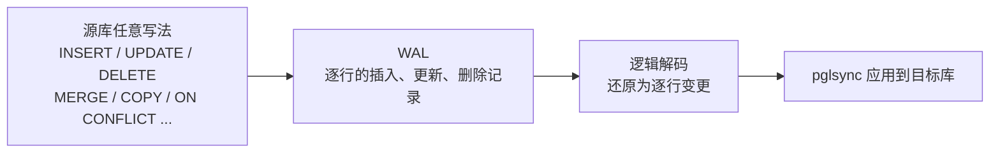

# 各类 SQL 操作的同步情况速查

逻辑复制同步的不是 SQL 语句本身，而是语句执行后**实际发生的行变更**：插入了哪些行、更新了哪些行、删除了哪些行。源库用什么 SQL 写法产生了这些变更都没有关系，目标库收到的始终是逐行的 INSERT / UPDATE / DELETE，由 pglsync 应用到目标库。



所以判断一种操作会不会被同步，只需要问一句：**它有没有通过 WAL 产生逐行的数据变更？**

---

## 1. 速查表

| 源库操作 | 是否同步 | 说明 |
|---|---|---|
| `INSERT` / `UPDATE` / `DELETE` | ✅ | 基本操作 |
| `INSERT ... ON CONFLICT DO UPDATE / DO NOTHING` | ✅ | 实际插入的行按 INSERT 同步，实际更新的行按 UPDATE 同步；`DO NOTHING` 跳过的行没有变更，不会同步任何东西 |
| **`MERGE`**（PG15+） | ✅ | 见第 2 节 |
| `COPY ... FROM` / `\copy` | ✅ | 见 [COPY_AND_BULK_LOAD.md](COPY_AND_BULK_LOAD.md) |
| `UPDATE` 修改了主键 | ✅ | pglsync 会在目标库按旧主键删除旧行，再写入新行 |
| `TRUNCATE` 普通表 | ✅ | 目标库同步执行 TRUNCATE |
| `TRUNCATE` 超表本身 | ✅ | 目标库同步执行 TRUNCATE |
| `TRUNCATE` 超表的某个 chunk | ⚠️ 忽略并告警 | 无法安全映射为目标库操作（配置项 `apply.chunk_truncate`） |
| 触发器、存储过程、函数里执行的增删改 | ✅ | 产生的行变更同样记入 WAL；目标库**不需要**有同样的触发器（如果有，注意不要重复执行业务逻辑） |
| 外键 `ON DELETE CASCADE` 级联删除 | ✅ | 级联删除的行也会逐行同步（被级联的表也需要在同步范围内） |
| 大批量操作（几百万行） | ✅ | 是一个大事务，目标库要等全部应用完才看到，见 [CASE_LARGE_DELETE.md](CASE_LARGE_DELETE.md) |
| 事务回滚（`ROLLBACK`） | 不同步 | 只有已提交的事务才会发送 |
| `drop_chunks` / 数据保留策略 | ❌ | 整块删除 chunk 表，没有逐行删除记录。需要在目标库执行同样的操作 |
| TimescaleDB 压缩 chunk 上的部分删除 | ⚠️ 可能不同步 | 可能整批删除压缩数据，没有逐行记录。删除后建议 `reconcile` 核对，不一致时用 `resync` |
| 写入 UNLOGGED 表 | ❌ | 不写 WAL |
| pg_bulkload 等直接写数据文件的工具 | ❌ | 绕过了 WAL |
| DDL（`CREATE` / `ALTER` / `DROP TABLE` 等） | ❌ | 逻辑复制不同步表结构变更，见 [USER_GUIDE.md 第 8.5 节](USER_GUIDE.md#85-修改表结构字段) |
| `VACUUM` / `ANALYZE` / `REINDEX` / `CLUSTER` | 无需同步 | 不改变数据内容，两边各自维护 |
| 序列（`nextval`） | ❌ | 序列的当前值不同步。目标库只由 pglsync 写入，一般不需要；如果将来要把目标库切换为主库，需要手动校正序列（`setval`） |

---

## 2. MERGE 语句

### 2.1 结论

**会同步。** MERGE（PG15 新增）根据匹配条件对目标表执行 INSERT、UPDATE 或 DELETE，每一行实际发生的变更都会写入 WAL，被逻辑解码为逐行变更，同步到目标库：

| MERGE 中的动作 | 目标库收到的变更 |
|---|---|
| `WHEN MATCHED THEN UPDATE SET ...` | 被更新的每一行 → UPDATE |
| `WHEN MATCHED THEN DELETE` | 被删除的每一行 → DELETE |
| `WHEN NOT MATCHED THEN INSERT ...` | 被插入的每一行 → INSERT |
| `WHEN NOT MATCHED BY SOURCE THEN DELETE / UPDATE`（PG17+） | 被删除或更新的每一行 → DELETE / UPDATE |
| `WHEN ... THEN DO NOTHING` | 没有变更，不同步 |

### 2.2 需要知道的几点

1. **目标库不需要支持 MERGE**：目标库收到的是逐行的增删改，不是 MERGE 语句本身。目标库是 PG14 也能正常同步。
2. **事务**：一条 MERGE 就是一个事务（自动提交模式下），里面所有的插入、更新、删除会**一起**同步到目标库，**一起**生效。目标库不会出现“插入同步过去了、删除还没同步”的中间状态。
3. **大批量 MERGE 就是大事务**：一次 MERGE 影响几百万行时，表现和大批量 DELETE 相同，目标库要等全部应用完才看到。日志中会输出“正在应用大事务…”的进度。
4. **复制标识**：MERGE 中的 UPDATE/DELETE 同样要求被发布的表有主键（复制标识）。同步范围内的表都已经通过 `check` 检查，不受影响。
5. **修改主键**：MERGE 的 UPDATE 修改了主键列时，pglsync 会按旧主键删除旧行、再写入新行。
6. **TimescaleDB 超表**：TimescaleDB 支持对超表执行 MERGE（具体以所用版本的官方说明为准），变更发生在各个 chunk 上，同样会被捕获并映射回超表。如果涉及已压缩的 chunk，执行后建议用 `reconcile` 核对。

### 2.3 动手验证

```sql
-- 源库（131）：准备一张临时的数据来源表
CREATE TEMP TABLE src_dict (id int PRIMARY KEY, name text);
INSERT INTO src_dict VALUES (1, 'merge-update'), (999999, 'merge-insert');

-- 对同步范围内的字典表执行 MERGE（表名、列名请按实际表结构调整）
MERGE INTO base_common_dict t
USING src_dict s ON t.id = s.id
WHEN MATCHED THEN UPDATE SET name = s.name
WHEN NOT MATCHED THEN INSERT (id, name) VALUES (s.id, s.name);
```

```sql
-- 几秒后在目标库（132）查询：id=1 已被更新，id=999999 已被插入
SELECT id, name FROM base_common_dict WHERE id IN (1, 999999);
```

验证完记得在**源库**把测试数据改回原样（这次修改同样会同步到目标库）。也可以先在测试环境验证。

---

## 3. 判断方法总结

遇到一种没见过的写法，按这三个问题判断：

1. **它是不是在一个已提交的事务里修改了数据？** 回滚的事务不会同步。
2. **这些修改有没有写 WAL？** UNLOGGED 表、绕过 WAL 的工具不会同步。
3. **修改是逐行发生的，还是整块替换数据文件？** `drop_chunks`、压缩数据的整批删除不会同步。

三个问题的答案分别是“是、有、逐行”，就一定会被同步。
