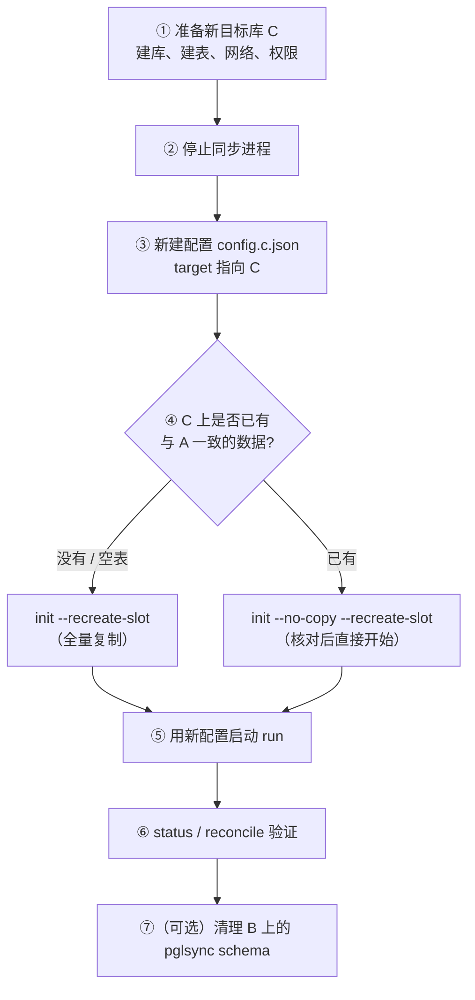
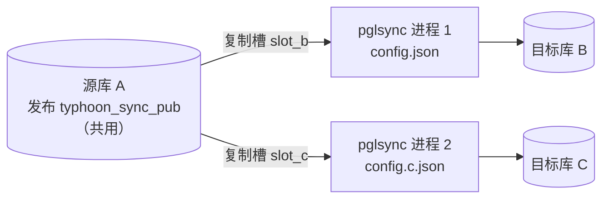

# 更换或新增同步目标库：操作手册

本文说明把数据同步到“另一个数据库”时的操作步骤，分三种情况：

| 场景 | 说明 | 详见 |
|---|---|---|
| **快速操作卡** | 停掉旧同步、换成新目标库，旧复制槽怎么处理（一页纸版本） | [第 0 节](#0-快速操作卡停掉旧同步换成新目标库复制槽怎么处理) |
| **A. 更换目标库** | 不再同步到原目标库 B，改为同步到新库 C | [第 2 节](#2-场景-a更换目标库-b--c) |
| **B. 新增一个目标库** | B 继续同步，同时也同步到 C（一个源库对多个目标库） | [第 3 节](#3-场景-b新增一个目标库b-和-c-同时同步) |
| **A+B. 平滑切换（推荐）** | 先按场景 B 让 B、C 并行同步，确认 C 没问题后再停掉 B | [第 4 节](#4-推荐平滑切换先并行再下线旧库) |

> 文中用 **A** 表示源库（例如 131），**B** 表示原目标库（例如 132），**C** 表示新目标库。
> 命令以 Python 版为例；Java 版和 Docker 部署的对应写法见 [第 6 节](#6-三种部署方式的命令对照)。

---

## 0. 快速操作卡：停掉旧同步、换成新目标库，复制槽怎么处理？

### 0.1 结论

**旧复制槽不能留着不管。** 复制槽建在**源库**上，它会让源库一直保留“同步进程还没确认”的 WAL。旧同步停掉后，没有进程再推进这个复制槽，源库的 `pg_wal` 会越积越多，最终撑满磁盘（或者超过 `max_slot_wal_keep_size` 后复制槽失效）。所以旧复制槽要么**重建给新同步用**，要么**删除**。

| 新配置里的 `slot_name` | 旧复制槽怎么处理 |
|---|---|
| **和原来一样（推荐）** | `init --recreate-slot` 会自动删除旧槽并新建，**不用手动删** |
| **换了新名字** | 先用**旧配置**执行 `drop --keep-publication` 删除旧槽（**一定要带 `--keep-publication`**，否则发布也会被删掉） |
| **以后完全不再从这个源库同步** | 执行不带参数的 `drop`：复制槽和发布一起删除，见 [第 5 节](#5-彻底停用不再从源库同步任何数据) |

另外两点：

- **发布不用删**，新同步直接复用；
- **旧目标库上的业务数据不会被删**，会停留在停止同步那一刻的状态。

### 0.2 操作步骤（源库不变，只换目标库）

```bash
# ① 停止旧的同步进程（程序会处理完当前事务、提交位点后再退出）
sudo systemctl stop pglsync              # 前台运行按 Ctrl+C；Docker 用 docker compose stop pglsync
python3 -m pglsync -c config.json status # 确认“是否活跃: 否”

# ② 准备新目标库：建库、建表（pg_dump -s 导出表结构并删掉其中的触发器）、超表、pg_hba.conf 放行
#    详见 2.2 节第 ① 步

# ③ 复制一份配置，只把 target 改成新目标库（旧配置留着，方便回退）
cp config.json config.new.json
vi config.new.json                       # 只改 target；slot_name、publication 保持不变

# ④ 用新配置初始化：自动删除旧复制槽并新建；发布直接复用
python3 -m pglsync -c config.new.json check
python3 -m pglsync -c config.new.json init --recreate-slot                                   # 新库是空表：全量复制
# 或：python3 -m pglsync -c config.new.json init --no-copy --recreate-slot --on-mismatch copy  # 新库已有数据：核对后开始

# ⑤ 用新配置启动同步（systemd 的话，把服务文件中 ExecStart 的 -c 参数改成 config.new.json）
sudo systemctl daemon-reload && sudo systemctl start pglsync

# ⑥ 验证
python3 -m pglsync -c config.new.json status       # 是否活跃: 是；落后接近 0
python3 -m pglsync -c config.new.json reconcile    # 全部一致

# ⑦（可选）清理旧目标库上 pglsync 自己的位点表（业务数据不受影响）
psql -h <旧目标库> -U postgres -d typhoon -c 'DROP SCHEMA pglsync CASCADE;'
```

**如果第 ③ 步把 `slot_name` 改成了新名字**，要在第 ④ 步之前先删除旧复制槽：

```bash
python3 -m pglsync -c config.json drop --keep-publication   # 用旧配置：删除旧复制槽和旧目标库上的位点，保留发布
```

完成后，在源库上确认只剩新的复制槽：

```sql
SELECT slot_name, active,
       pg_size_pretty(pg_wal_lsn_diff(pg_current_wal_lsn(), restart_lsn)) AS retained_wal
FROM pg_replication_slots;
```

### 0.3 如果源库也换了

源库换了，就是一条全新的同步链路，和旧链路没有任何关系：

1. **清理旧源库**：用旧配置执行**不带参数**的 `drop`，删除旧源库上的复制槽和发布：
   ```bash
   sudo systemctl stop pglsync
   python3 -m pglsync -c config.json drop
   ```
   如果旧源库以后不再需要逻辑复制，可以把它的 `wal_level` 改回 `replica`（需要重启）。
2. **配置新源库**：按 [USER_GUIDE.md 第 2.1 节](USER_GUIDE.md#21-源库131配置) 修改参数（`wal_level = logical` 等，需要重启）。
3. **新建配置**：`source` 和 `target` 都指向新库。
4. **按首次部署流程执行**：`check` → `setup` → `init`（或 `init --no-copy`）→ `run`。

### 0.4 三种部署方式的写法

| 步骤 | Python 版 | Java 版 | Docker |
|---|---|---|---|
| 停止 | `systemctl stop pglsync` | `systemctl stop pglsync-java` | `docker compose stop pglsync` |
| 重建复制槽并初始化 | `python3 -m pglsync -c config.new.json init --recreate-slot` | `java -jar pglsync.jar init --recreate-slot --spring.config.additional-location=file:application-new.yml` | 把新配置挂载为 `/app/config/config.json`，然后 `docker compose run --rm pglsync init --recreate-slot` |
| 删除旧复制槽，保留发布 | `drop --keep-publication` | `drop --keep-publication` | `docker compose run --rm pglsync drop -y --keep-publication` |
| 彻底停用 | `drop` | `drop` | `docker compose run --rm pglsync drop -y` |

---

## 1. 先搞清楚：哪些对象跟“目标库”绑定，哪些不绑定

| 对象 | 所在位置 | 跟谁绑定 | 换目标库时怎么处理 |
|---|---|---|---|
| **发布**（publication） | 源库 A | 只跟“同步哪些表”有关，**与目标库无关** | **保留复用**。多个目标库可以共用同一个发布 |
| **复制槽**（slot） | 源库 A | 一个复制槽 = **一个消费者的读取位置**，同一时刻只能有一个同步进程使用 | 换目标库：**重建**（`init --recreate-slot`）。新增目标库：**另建一个**，不能共用 |
| **同步位点**（`pglsync.sync_state` / `table_state`） | 目标库 | 记录“这个目标库已经应用到哪里” | 每个目标库各有一份。新目标库由 `init` 自动创建；旧目标库不用了可以删除 |
| 配置文件 | 同步程序所在机器 | 一个配置 = 一条“源库 → 目标库”的同步链路 | 换目标库：修改或新建配置；新增目标库：**新建一份配置** |

两条关键结论：

1. **发布不需要删除。** 只要还从源库 A 同步数据，发布就一直复用。只有彻底不再从 A 同步任何数据时，才需要删除发布。
2. **复制槽必须和目标库一一对应。** 复制槽记录的是“某个消费者读到哪里”，新目标库 C 的数据状态和 B 不同，不能直接接着 B 的复制槽读。所以换目标库要重建复制槽，新增目标库要另建一个。**不再使用的复制槽一定要删除**，否则源库会一直为它保留 WAL，直到磁盘写满。

---

## 2. 场景 A：更换目标库（B → C）

### 2.1 流程总览



整个过程中：

- **发布不动**；
- **旧复制槽**会在第 ④ 步被 `--recreate-slot` 自动删除，并新建一个，**不需要手动删除**；
- 从第 ② 步停止同步开始，到第 ⑤ 步启动为止，源库 A 的变更不会丢：A 会为复制槽保留 WAL，而新复制槽的一致性快照会包含停止期间的所有数据。

### 2.2 详细步骤

**① 准备新目标库 C**

C 不需要修改任何 WAL 参数，只需要：

```bash
# 1) 建库（在 C 上）
psql -h <C地址> -U postgres -c "CREATE DATABASE typhoon;"

# 2) 建表：从源库导出表结构，导入 C
pg_dump -h 192.168.234.131 -U postgres -s \
  -t 'public.base_*' -t public.tcrealtime -t public.tcensemblerealtime -t public.tcrealtime_algorithm \
  -t public.fcst_custom_group -t 'public.tc_product_*' typhoon > schema.sql
#    打开 schema.sql，删掉其中的触发器（CREATE TRIGGER ...）
psql -h <C地址> -U postgres -d typhoon -f schema.sql
```

```sql
-- 3) 超表：C 也要安装 TimescaleDB，并把表转成超表
CREATE EXTENSION IF NOT EXISTS timescaledb;
SELECT create_hypertable('public.tcrealtime', 'datatime', migrate_data => true, if_not_exists => true);
SELECT create_hypertable('public.tcensemblerealtime', 'datatime', migrate_data => true, if_not_exists => true);
```

4) **网络与权限**：
- C 的 `pg_hba.conf` 要允许**同步程序所在的机器**连接；
- 防火墙放行 C 的端口；
- 同步用户需要能在 C 上建 schema（用于存放 `pglsync.sync_state`），用超级用户最简单，或者事先执行 `CREATE SCHEMA pglsync AUTHORIZATION <同步用户>;`。

先在同步程序所在的机器上测试一下连通性：

```bash
psql -h <C地址> -p 5432 -U postgres -d typhoon -c "select 1"
```

**② 停止同步进程**

```bash
sudo systemctl stop pglsync          # systemd 托管时
# 前台运行的话按 Ctrl+C；Docker：docker compose stop pglsync
```

程序会处理完当前事务、提交位点后才退出。确认已经停下：执行 `python3 -m pglsync -c config.json status`，“是否活跃”应该显示“否”。

**③ 新建配置文件，target 指向 C**

**建议复制一份新配置，不要直接改旧的**，这样需要回退时旧配置还在：

```bash
cp config.json config.c.json
vi config.c.json
```

```jsonc
{
  "source": { ...保持不变（还是源库 A）... },
  "target": {
    "host": "<C地址>", "port": 5432, "dbname": "typhoon",
    "user": "postgres", "password_env": "PGLSYNC_TARGET_C_PASSWORD"
  },
  "slot_name": "typhoon_sync_slot",    // 可以沿用原来的名字（会被重建），也可以改个新名字
  "publication": "typhoon_sync_pub",   // 保持不变，复用原来的发布
  ...
  "logging": { "file": "/data/pglsync/pglsync-c.log", "level": "INFO" }
}
```

> 如果 `slot_name` 改成了新名字，第 ④ 步就不需要 `--recreate-slot`，但**必须**另外删除旧的复制槽（见 2.3 节），否则它会一直保留 WAL。沿用原来的名字更省事。

**④ 初始化**（二选一）

```bash
C=config.c.json
python3 -m pglsync -c $C check                       # 确认源库和发布正常

# 情况 1：C 是空表 → 删除旧复制槽并新建，全量复制到 C
python3 -m pglsync -c $C init --recreate-slot

# 情况 2：C 已经有和 A 一致的数据（比如是从 B 整库复制过来的）→ 核对后直接开始，不重新复制
python3 -m pglsync -c $C init --no-copy --recreate-slot
python3 -m pglsync -c $C init --no-copy --recreate-slot --on-mismatch copy   # 核对不一致时，只重新复制不一致的表
```

`--recreate-slot` 会先删除同名的旧复制槽（要求没有进程在使用它），再新建复制槽并导出快照。之后的复制或核对都基于这个新快照，所以 C 的数据和新复制槽的起点完全对齐。

**⑤ 用新配置启动同步**

```bash
python3 -m pglsync -c $C run           # 前台运行
# systemd：把服务文件里 ExecStart 的 -c 参数改成 config.c.json，然后：
sudo systemctl daemon-reload && sudo systemctl start pglsync
```

**⑥ 验证**

```bash
python3 -m pglsync -c $C status        # “是否活跃: 是”，“落后”接近 0；“目标库同步位点”显示的是 C 上的位点
python3 -m pglsync -c $C reconcile     # 全部一致
```

**⑦（可选）清理原目标库 B**

B 上的**业务数据不受任何影响**，会保留在停止同步那一刻的状态。B 上 pglsync 自己用的位点表已经没用了，可以删除：

```sql
-- 在 B 上执行
DROP SCHEMA pglsync CASCADE;
```

### 2.3 如果新配置用了新的复制槽名

此时旧复制槽不会被 `--recreate-slot` 删掉，需要**在第 ④ 步之前**用**旧配置**执行一次：

```bash
python3 -m pglsync -c config.json drop --keep-publication
```

这条命令会：

- 删除旧复制槽；
- 删除 B 上的同步位点；
- 保留发布（`--keep-publication`）。

> [!WARNING]
> **一定要加 `--keep-publication`。** 不加的话，发布也会被删除，新配置还得重新执行 `setup`。如果另外还有一条同步链路共用这个发布（场景 B），它会立刻中断。

### 2.4 回退

如果 C 出了问题，想退回到 B：旧复制槽已经被删除了，所以要用旧配置重新初始化一次：

```bash
sudo systemctl stop pglsync
python3 -m pglsync -c config.json init --no-copy --recreate-slot --on-mismatch copy
sudo systemctl start pglsync      # ExecStart 改回 config.json
```

B 停止同步期间缺少的数据，会因为核对不一致而被重新复制（只复制不一致的表）。

想要更低风险的切换方式，见 [第 4 节](#4-推荐平滑切换先并行再下线旧库)：并行运行一段时间，确认 C 没问题后再下线 B。

---

## 3. 场景 B：新增一个目标库（B 和 C 同时同步）

### 3.1 原理



- **每个目标库：一个复制槽、一份配置、一个同步进程**，三者一一对应；
- **发布可以共用**（同步的表相同）。如果两边要同步的表不一样，就用两个不同的发布名；
- 两条链路互相独立：各自断点续传，C 停了不影响 B。

### 3.2 步骤

**① 准备新目标库 C**：同 [2.2 节第 ① 步](#22-详细步骤)。

**② 新建配置 `config.c.json`**：必须修改下面这几项，其他照抄 `config.json`。

```jsonc
{
  "source": { ...与 config.json 相同... },
  "target": { "host": "<C地址>", ... },
  "slot_name": "typhoon_sync_slot_c",     // ★ 必须和 B 的复制槽名不同
  "publication": "typhoon_sync_pub",      // 共用同一个发布（表不同的话就用新名字）
  "logging": { "file": "/data/pglsync/pglsync-c.log" }   // ★ 日志文件分开
}
```

**③ 检查源库容量**：多一条同步链路，就多占一个复制槽和一个 WAL 发送进程。

```sql
SHOW max_replication_slots;    -- 需要 >= 现有复制槽数 + 1（resync 还会临时再占一个）
SHOW max_wal_senders;
SELECT count(*) FROM pg_replication_slots;
```

默认值都是 10，两三条链路完全够用。

**④ 初始化 C 的链路**（**B 的同步进程不用停**）

```bash
C=config.c.json
python3 -m pglsync -c $C setup                 # 发布已存在，只会补充缺少的表；没有变更时显示“已就绪”
python3 -m pglsync -c $C init                  # C 为空：全量复制
# 或者：python3 -m pglsync -c $C init --no-copy [--on-mismatch copy]
```

**⑤ 启动第二个同步进程**

systemd：复制一份服务文件。

```bash
sudo cp /etc/systemd/system/pglsync.service /etc/systemd/system/pglsync-c.service
sudo sed -i 's#config.json#config.c.json#' /etc/systemd/system/pglsync-c.service
sudo systemctl daemon-reload && sudo systemctl enable --now pglsync-c
```

Docker：在 `docker-compose.yml` 中再加一个服务。

```yaml
  pglsync-c:
    image: pglsync:1.0.0
    container_name: pglsync-c
    network_mode: host
    restart: unless-stopped
    stop_grace_period: 120s
    env_file: [./pglsync.env]
    volumes:
      - ./config.c.json:/app/config/config.json:ro
      - ./logs-c:/app/logs
    command: ["run"]
```

**⑥ 验证**

```bash
python3 -m pglsync -c config.json   status     # B 的链路
python3 -m pglsync -c config.c.json status     # C 的链路
python3 -m pglsync -c config.c.json reconcile
```

### 3.3 多目标库时的注意事项

| 注意事项 | 说明 |
|---|---|
| **复制槽名不能重复** | 两份配置用了同一个 `slot_name` 时，第二个进程会因为“复制槽正被占用”而一直重连；如果对其中一份执行 `init --recreate-slot`，还会把另一条链路的复制槽删掉 |
| **`drop` 时一定要加 `--keep-publication`** | 共用发布时，对任何一条链路执行不带 `--keep-publication` 的 `drop`，都会删除共用的发布，导致另一条链路中断 |
| **源库开销翻倍** | 每个复制槽都会独立解码一遍全库 WAL。两三条链路一般没问题，再多就要关注源库 CPU |
| **WAL 由最慢的那条链路决定** | 任何一条链路停掉或跟不上，源库都会为它保留 WAL。每条链路都要用 `status` 监控 |
| **新增表要分别处理** | `setup` 执行一次即可（发布是共用的）。但 `resync` 要对**每条链路**分别执行（先停对应的进程） |
| **表结构变更** | 每个目标库都要执行同样的 DDL（参考 USER_GUIDE 第 8.5 节的先后顺序） |

---

## 4. 推荐：平滑切换（先并行，再下线旧库）

想把目标库从 B 换成 C，又希望随时能退回，可以把场景 B 和场景 A 结合起来：


第 ④ 步下线 B 的链路：

```bash
sudo systemctl disable --now pglsync                          # 停止并禁用 B 的同步进程
python3 -m pglsync -c config.json drop --keep-publication     # 删除 B 的复制槽和 B 上的位点，保留共用发布
```

整个过程中 B 始终保持同步，C 出问题随时可以退回 B，不需要重新初始化。代价是并行期间源库多解码一份 WAL。

---

## 5. 彻底停用（不再从源库同步任何数据）

```bash
sudo systemctl disable --now pglsync                  # 停止所有同步进程（多条链路要逐个停）
python3 -m pglsync -c config.json drop                # 删除复制槽 + 删除发布 + 删除目标库上的位点
# 多条链路时：前面几条用 drop --keep-publication，最后一条再用不带参数的 drop
```

在源库上确认已经清理干净：

```sql
SELECT slot_name FROM pg_replication_slots;    -- 不应再有 pglsync 的复制槽
SELECT pubname FROM pg_publication;            -- 不应再有 pglsync 的发布
```

如果不再需要逻辑复制，可以把源库的 `wal_level` 改回 `replica`（需要重启），减少 WAL 量。

---

## 6. 三种部署方式的命令对照

| 操作 | Python 版 | Java 版 | Docker（Python 镜像） |
|---|---|---|---|
| 停止同步 | `systemctl stop pglsync` | `systemctl stop pglsync-java` | `docker compose stop pglsync` |
| 指定配置 | `-c config.c.json` | `--spring.config.additional-location=file:/path/application-c.yml` | 挂载为 `/app/config/config.json` |
| 重建复制槽并全量复制 | `init --recreate-slot` | `init --recreate-slot` | `docker compose run --rm pglsync init --recreate-slot` |
| 重建复制槽并核对现有数据 | `init --no-copy --recreate-slot --on-mismatch copy` | `init --no-copy --recreate-slot --on-mismatch=copy` | `docker compose run --rm pglsync init --no-copy --recreate-slot --on-mismatch copy` |
| 删除复制槽，保留发布 | `drop --keep-publication` | `drop --keep-publication` | `docker compose run --rm pglsync drop -y --keep-publication` |
| 查看状态 | `status` | `status` | `docker compose run --rm pglsync status` |

Java 版新增一个目标库时，新建 `application-c.yml`，至少修改下面这几项：

```yaml
pglsync:
  target: { host: <C地址>, port: 5432, dbname: typhoon, user: postgres, password: ${PGLSYNC_TARGET_C_PASSWORD:} }
  slot-name: typhoon_sync_slot_c
logging:
  file:
    name: logs/pglsync-c.log
```

---

## 7. 常见问题

**Q1：换目标库，必须删除发布吗？**

不需要。发布只决定“同步哪些表”，与目标库无关，继续复用即可。只有彻底不再从这个源库同步时才删除。

**Q2：换目标库，必须删除复制槽吗？**

旧复制槽必须处理掉，但不一定要手动删：

- 新配置沿用同一个复制槽名：`init --recreate-slot` 会自动删除旧槽并新建；
- 用了新的复制槽名：需要用旧配置执行 `drop --keep-publication` 删除旧槽。

不管哪种方式，**都不能留着一个没人用的复制槽**。

**Q3：能不能不重建复制槽，让 C 直接接着 B 的进度同步？**

可以，但前提是 C 的数据和 B **完全一样，包括 `pglsync` schema 里的位点表**。做法是：

1. 停止同步；
2. 把 B 的业务表**和** `pglsync` schema 一起完整复制到 C（比如 `pg_dump` 加 `pg_restore`）；
3. 只修改配置中的 `target` 指向 C；
4. 启动 `run`，程序会读取 C 上的位点，从 B 停下的位置继续。

这种方法要先完整搬一遍数据，而 `init --no-copy` 会自动核对两边是否一致，更不容易出错，所以一般推荐 2.2 节的做法。

**Q4：停止同步期间源库还在写，会丢数据吗？**

不会：

- 停止期间，复制槽会为同步进程保留 WAL；
- 场景 A 中 `init --recreate-slot` 新建的快照，包含了此前所有已提交的数据；快照之后的变更由新复制槽继续发送。

需要注意的只是停止时间不要太长，以免 WAL 积压超过 `max_slot_wal_keep_size`。

**Q5：两个目标库能共用一个复制槽吗？**

不能。一个复制槽同一时刻只能被一个进程读取，而且它记录的是“一个消费者”的进度。两个目标库的进度不可能完全一致，必须各用一个复制槽。原理见 [REPLICATION_SLOT.md](REPLICATION_SLOT.md)。

**Q6：B 上已经同步过来的数据会被删除吗？**

不会。pglsync 的任何命令都不会删除 B 上的业务数据（`drop` 只删除 B 上 `pglsync` schema 里的位点记录）。B 会停留在停止同步那一刻的状态。
