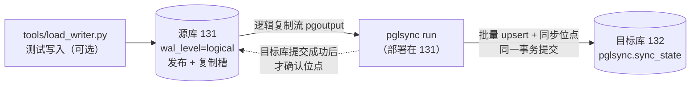
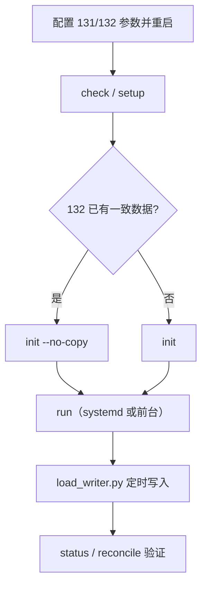

# pglsync 完整使用手册

本手册是 pglsync 的统一使用文档。以测试环境 **192.168.234.131 → 192.168.234.132** 为例，涵盖以下内容：

1. 数据库配置（源库、目标库、建表）
2. 程序安装与配置文件
3. 同步程序的运行方式（初始化、增量同步、后台运行、监控、核对）
4. 测试写入脚本的使用方式
5. 端到端测试流程、常见问题排查、生产切换要点

> 相关文档：[LOGICAL_SYNC.md](LOGICAL_SYNC.md)（原理与限制） · [DEPLOYMENT_GUIDE.md](DEPLOYMENT_GUIDE.md)（生产上线手册） · [TEST_ENV_SETUP.md](TEST_ENV_SETUP.md)（测试环境速查）

---

## 目录

- [0. 方案概述](#0-方案概述)
- [1. 环境要求](#1-环境要求)
- [2. 数据库配置](#2-数据库配置)
- [3. 安装程序](#3-安装程序)
- [4. 配置文件说明](#4-配置文件说明)
- [5. 同步程序的运行方式](#5-同步程序的运行方式)
- [6. 测试写入脚本的使用方式](#6-测试写入脚本的使用方式)
- [7. 端到端测试流程](#7-端到端测试流程)
- [8. 常见问题排查](#8-常见问题排查)
- [9. 生产环境切换要点](#9-生产环境切换要点)

---

## 0. 方案概述

pglsync 读取源库 WAL 的逻辑解码流（PostgreSQL 内置的 `pgoutput` 插件），把指定表的增、删、改、TRUNCATE 按**源库提交顺序**应用到目标库。



和旧的触发器方案相比，主要有以下保证：

| 保证 | 实现方式 |
|---|---|
| 不丢数据 | WAL 按提交顺序发送，不会再出现“长事务晚提交被跳过”的问题 |
| 断点续传 | 同步位点与数据在目标库同一个事务里提交；目标库提交成功后才向源库确认 |
| 起点一致 | 初始化时使用复制槽导出的一致性快照，全量复制（或核对）与增量起点是同一时刻 |
| 可重放 | 所有写入都是幂等的 `INSERT ... ON CONFLICT DO UPDATE`，重复应用结果不变 |
| 可核对 | `reconcile` 按行数和整行哈希比对两边，能定位到具体日期和主键 |

### 仓库目录结构

```
cdc-pgtables-sync/
├── pglsync/                 同步程序（python3 -m pglsync）
├── tools/
│   ├── load_writer.py       测试写入脚本
│   └── test_schema.sql      测试用示例表结构
├── tests/                   单元测试
├── deploy/pglsync.service   systemd 服务模板
├── config.example.json      生产配置样例
├── config.test.json         测试环境配置（131 → 132）
└── docs/                    文档
```

---

## 1. 环境要求

| 项目 | 要求 |
|---|---|
| PostgreSQL | 10 及以上。使用 TimescaleDB 时推荐 **15 及以上** |
| TimescaleDB | 源库和目标库都要安装，版本尽量一致 |
| Python | 3.6 及以上，部署在源库服务器上 |
| Python 依赖 | `psycopg2-binary >= 2.8.6` |
| 网络 | 运行 pglsync 的机器要能访问源库和目标库的 5432 端口 |

本手册假设程序部署在 **131 的 `/opt/cdc-pgtables-sync`** 目录。

---

## 2. 数据库配置

### 2.1 源库（131）配置

#### 2.1.1 找到配置文件

```sql
SHOW config_file;     -- postgresql.conf 的路径
SHOW hba_file;        -- pg_hba.conf 的路径
SELECT version();     -- PostgreSQL 版本
SELECT extversion FROM pg_extension WHERE extname = 'timescaledb';   -- TimescaleDB 版本
```

#### 2.1.2 postgresql.conf 参数

| 参数 | 推荐值 | 生效方式 | 说明 |
|---|---|---|---|
| `wal_level` | `logical` | **重启** | **必须改。** 改成 `logical` 后，WAL 里才有逻辑解码需要的行级信息 |
| `max_replication_slots` | `10` | **重启** | 复制槽上限，pglsync 只用 1 个。默认值就是 10 |
| `max_wal_senders` | `10` | **重启** | WAL 发送进程上限，每条复制连接占 1 个。默认值就是 10 |
| `listen_addresses` | `'*'` | **重启** | 默认只监听 localhost，改成 `'*'` 才能接受其他机器或本机 IP 的连接 |
| `shared_preload_libraries` | 包含 `'timescaledb'` | **重启** | 使用 TimescaleDB 时需要。注意保留已有的其他库，多个库用逗号分隔 |
| `max_slot_wal_keep_size` | 如 `'10GB'` | 重新加载 | PG13 及以上才有。复制槽最多保留多少 WAL，防止同步进程停止后 WAL 撑满磁盘。**按剩余磁盘空间设置**；超出后复制槽失效，需要重新 `init` |
| `wal_sender_timeout` | `60s`（默认） | 重新加载 | 复制连接超过这个时间无响应就断开。pglsync 每 10 秒发一次心跳，默认值够用 |
| `logical_decoding_work_mem` | `64MB`（默认） | 重新加载 | PG13 及以上才有。单个事务解码超过这个大小就写临时文件。大批量事务较多时可以调到 `256MB` |

用 SQL 修改（会写入 `postgresql.auto.conf`）：

```sql
ALTER SYSTEM SET wal_level = 'logical';
ALTER SYSTEM SET max_replication_slots = 10;
ALTER SYSTEM SET max_wal_senders = 10;
ALTER SYSTEM SET listen_addresses = '*';
ALTER SYSTEM SET max_slot_wal_keep_size = '10GB';   -- PG13+，按磁盘调整
-- ALTER SYSTEM SET shared_preload_libraries = 'timescaledb';   -- 先 SHOW 查看已有值，不要覆盖掉
```

#### 2.1.3 pg_hba.conf：允许连接

在 `pg_hba.conf` **靠前的位置**加上下面这行（规则从上往下匹配）：

```
# TYPE  DATABASE  USER      ADDRESS             METHOD
host    typhoon   postgres  192.168.234.0/24    scram-sha-256
```

- **逻辑复制连接按数据库名匹配**，写 `typhoon` 就行，不需要 `replication` 关键字。`replication` 只用于物理复制和 `pg_basebackup`；
- pglsync 在 131 上通过 `192.168.234.131` 连接自己，也要靠这条规则放行；
- 如果密码是 md5 加密的（`SHOW password_encryption;` 结果为 `md5`），`METHOD` 写 `md5`。

#### 2.1.4 重启并放行防火墙

```bash
sudo systemctl restart postgresql          # 服务名可能是 postgresql-15 / postgresql@15-main
# 不确定服务名时：systemctl list-units | grep -i postgres

# 防火墙（二选一）
sudo firewall-cmd --permanent --add-port=5432/tcp && sudo firewall-cmd --reload   # CentOS/RHEL/Rocky
sudo ufw allow 5432/tcp                                                           # Ubuntu
```

只修改了 `pg_hba.conf` 或者“重新加载”类参数时，不需要重启，执行 `SELECT pg_reload_conf();` 即可。

#### 2.1.5 验证

```sql
SELECT name, setting, pending_restart
FROM pg_settings
WHERE name IN ('wal_level', 'max_replication_slots', 'max_wal_senders', 'listen_addresses',
               'max_slot_wal_keep_size', 'shared_preload_libraries');
```

`wal_level` 应为 `logical`，并且所有行的 `pending_restart` 都应为 `f`。

#### 2.1.6 用户权限

测试直接用超级用户 `postgres` 即可。生产环境需要注意：

- 创建复制槽、读取复制流：需要 `REPLICATION` 权限或超级用户；
- 创建 `FOR ALL TABLES` 或 `TABLES IN SCHEMA` 类型的发布：需要**超级用户**。

### 2.2 目标库（132）配置

目标库**不需要**修改 WAL 参数，只需要：

1. `listen_addresses = '*'`（需要重启），以及在 `pg_hba.conf` 中允许 131 连接：
   ```
   host    typhoon   postgres  192.168.234.0/24    scram-sha-256
   ```
2. 防火墙放行 5432 端口；
3. 源表是超表的话，目标库也安装 TimescaleDB，并把表建成超表；
4. 表结构与源库相同，**主键约束必须存在**（写入时的 `ON CONFLICT` 依赖主键）；
5. 同步位点表 `pglsync.sync_state` 由程序自动创建。

> [!IMPORTANT]
> 目标库上的这些表**只能由 pglsync 写入**。人工修改会造成数据不一致，而且同步程序发现不了。

### 2.3 建表

| 情况 | 做法 |
|---|---|
| **两边已经建好表，数据也已经一致**（你现在的情况） | 跳过本节，初始化时用 `init --no-copy`（见 5.3 节） |
| 需要和生产表结构一致 | 用 `pg_dump -s` 导出生产表结构（见下文） |
| 只是功能测试 | 用 `tools/test_schema.sql` |

**导出生产表结构：**

```bash
pg_dump -h <生产库> -p 5000 -U postgres -s -t 'public.base_*' \
        -t public.tcrealtime -t public.tcensemblerealtime -t public.tcrealtime_algorithm \
        -t public.fcst_custom_group -t 'public.tc_product_*' typhoon > schema.sql
```

导入前打开 `schema.sql`，删掉旧 CDC 方案的触发器（`CREATE TRIGGER ... cdc...`）和 `ts_insert_blocker` 触发器。然后在两个库上分别导入，并把两张超表转成超表：

```bash
psql -h 192.168.234.131 -U postgres -d typhoon -f schema.sql
psql -h 192.168.234.132 -U postgres -d typhoon -f schema.sql
```

```sql
-- 131、132 都要执行
CREATE EXTENSION IF NOT EXISTS timescaledb;
SELECT create_hypertable('public.tcrealtime', 'datatime', migrate_data => true, if_not_exists => true);
SELECT create_hypertable('public.tcensemblerealtime', 'datatime', migrate_data => true, if_not_exists => true);
```

**使用示例表结构**（只包含两张超表）：

```bash
psql -h 192.168.234.131 -U postgres -d typhoon -f tools/test_schema.sql
psql -h 192.168.234.132 -U postgres -d typhoon -f tools/test_schema.sql
```

---

## 3. 安装程序

### 3.1 获取代码

```bash
cd /opt
git clone -b test/local-vm-env git@github.com:Retror/cdc-pgtables-sync.git
cd /opt/cdc-pgtables-sync

# 以后更新代码
git pull
```

### 3.2 安装依赖

```bash
pip3 install -r requirements.txt
```

服务器不能上网时，在 Python 版本和 CPU 架构相同、并且能上网的机器上下载离线包：

```bash
pip3 download psycopg2-binary -d ./wheels
# 拷贝到服务器后执行：
pip3 install --no-index --find-links ./wheels psycopg2-binary
```

### 3.3 自检

```bash
python3 -m pglsync --version
python3 -m unittest discover -s tests        # 单元测试，不需要连接数据库
```

---

## 4. 配置文件说明

测试环境使用 [config.test.json](../config.test.json)。生产环境可以参考 [config.example.json](../config.example.json)，复制成 `/data/pglsync/config.json` 后修改。

```jsonc
{
  "source": {                      // 源库连接，支持任意 libpq 参数（sslmode 等）
    "host": "192.168.234.131", "port": 5432, "dbname": "typhoon",
    "user": "postgres",
    "password": "123456"           // 测试环境直接写密码；生产环境改用 "password_env": "环境变量名"
  },
  "target": { ... 132 ... },       // 目标库连接，写法同 source

  "slot_name": "pglsync_test_slot",     // 复制槽名
  "publication": "pglsync_test_pub",    // 发布名
  "state_schema": "pglsync",            // 目标库中存放同步位点表的 schema
  "publication_mode": "auto",           // auto / schema / all，见下表
  "chunk_schemas": ["_timescaledb_internal"],   // TimescaleDB chunk 所在的 schema

  "tables": {                            // 需要同步的表
    "public.base_common_dict": {},       // pk 不填时自动取源表主键
    "public.tcrealtime": {
      "pk": ["id", "datatime"],          // 主键列
      "time_column": "datatime",         // reconcile 按时间分桶核对时使用
      "bucket": "day"                    // hour / day / week / month
    }
  },

  "apply": {
    "batch_max_changes": 5000,     // 累计多少条变更提交一次目标库事务
    "batch_max_seconds": 1.0,      // 或者最多攒多少秒
    "upsert_group_size": 500,      // 每条批量 INSERT 最多多少行
    "on_missing_row": "warn",      // 部分列 UPDATE 找不到目标行时：warn 记录警告 / error 停止同步
    "chunk_truncate": "warn"       // 源库单独 TRUNCATE 某个 chunk 时：warn 忽略并告警 / error 停止同步
  },
  "stream": {
    "status_interval_seconds": 10, // 向源库发送心跳和确认位点的间隔
    "retry_initial_seconds": 5,    // 断线后首次重连等待时间，之后每次翻倍
    "retry_max_seconds": 60,       // 重连等待时间上限
    "stats_interval_seconds": 60   // 统计日志的输出间隔
  },
  "logging": { "file": "logs/pglsync-test.log", "level": "INFO" }
}
```

`publication_mode` 的取值：

| 值 | 含义 | 适用情况 |
|---|---|---|
| `auto` | 自动选择：没装 TimescaleDB 时只发布配置的表；PG15 及以上用 `schema`；PG14 及以下用 `all` | 默认，推荐 |
| `schema` | 发布配置的表，加上 `TABLES IN SCHEMA _timescaledb_internal`（新 chunk 自动包含在内） | PG15 及以上 + TimescaleDB |
| `all` | `FOR ALL TABLES`，库内所有表都必须有主键 | PG14 及以下 + TimescaleDB |

> [!NOTE]
> 配置文件中以 `_` 开头的键（比如 `_comment`）会被忽略，可以用来写注释。

---

## 5. 同步程序的运行方式

以下命令都在 `/opt/cdc-pgtables-sync` 目录下执行。为了简洁，先设置一个变量：

```bash
cd /opt/cdc-pgtables-sync
C=config.test.json
```

### 5.1 命令总览

| 命令 | 作用 | 什么时候用 |
|---|---|---|
| `check` | 只读检查源库参数、表、复制标识 | 每次部署前 |
| `setup` | 在源库创建或更新发布 | 首次部署、新增同步表后 |
| `init` | 创建复制槽，并全量复制到目标库（会 TRUNCATE 目标表） | 目标库为空或数据不可信 |
| `init --no-copy` | 创建复制槽，**用快照核对两边数据，以目标库现有数据为起点** | 目标库已有一致数据 |
| `run` | 常驻进程，执行增量同步 | 初始化完成后 |
| `status` | 查看复制槽是否活跃、WAL 积压、同步位点 | 日常监控 |
| `reconcile` | 按行数和整行哈希核对两边数据 | 定期核对、排查问题 |
| `drop` | 删除复制槽、发布和同步位点 | 停用同步时，**必须执行** |

通用参数：`-c 配置文件`、`-v`（输出 DEBUG 日志）。也可以用环境变量 `PGLSYNC_CONFIG` 指定配置文件。

### 5.2 第一步：检查与创建发布

```bash
python3 -m pglsync -c $C check
```

输出分为“警告”和“问题（必须解决）”两类。常见问题：

- `wal_level = replica`：回到 2.1 节修改参数并重启；
- 有表缺少复制标识：发布范围内没有主键的表，加入发布后**源库对它们的 UPDATE/DELETE 会直接报错**。推荐先加主键，或者执行 `setup --fix-replica-identity`。

检查通过后创建发布：

```bash
python3 -m pglsync -c $C setup
```

### 5.3 第二步：初始化（二选一）

#### 方式 A：目标库已有一致数据 → `init --no-copy`（你现在的情况）

```bash
python3 -m pglsync -c $C init --no-copy
```

执行过程：

1. 在 131 上创建复制槽，同时拿到一个**一致性快照**和对应的 WAL 位点；
2. 用这个快照读取 131，和 132 逐表比较行数和整行哈希（超表按天比较）；
3. **全部一致**：132 的业务数据一行不动，只记录同步位点；
4. **有不一致**：默认放弃初始化，删除复制槽，不做任何修改，并列出差异。

示例输出：

```
表                                                源库(快照)行数     目标库行数  结果
-----------------------------------------------------------------------------------------------
public.base_common_dict                                    356            356  一致  (0.0s)
public.tcrealtime                                      1,203,456      1,203,456  一致  (2.3s)
...
初始化完成，耗时 5.1s，重新复制 0 张表，同步位点已设为 4/3213BD08
```

发现不一致时，可以选择：

| 命令 | 效果 |
|---|---|
| `init --no-copy --on-mismatch copy` | 只重新复制不一致的表，其他表不动（推荐） |
| `init` | 全部重新复制 |
| `init --no-copy --on-mismatch ignore` | 保留差异，直接开始同步（不推荐） |
| `init --no-copy --skip-verify` | 跳过核对，需要自己保证两边一致，且这期间源库没有写入 |

> [!TIP]
> 核对基于快照，**初始化期间 131 可以照常写入**。但如果在上次手工同步之后 131 有过新写入，对应的表会显示不一致，用 `--on-mismatch copy` 补上即可。

#### 方式 B：目标库为空或数据不可信 → `init`

```bash
python3 -m pglsync -c $C init
```

程序会在**一个事务里**把所有配置的表先 TRUNCATE，再用快照全量复制。复制期间这些表被锁住，查询目标库的业务会一直等待，直到复制完成。中途失败会整体回滚，并自动删除复制槽。

#### 重新初始化

复制槽已经存在时，`init` 会拒绝执行。需要重新初始化时，先停掉 `run`，再执行：

```bash
python3 -m pglsync -c $C init --recreate-slot              # 全量复制
python3 -m pglsync -c $C init --no-copy --recreate-slot    # 核对后从现有数据开始
```

### 5.4 第三步：启动增量同步

#### 前台运行（调试用）

```bash
python3 -m pglsync -c $C run          # Ctrl+C 停止，会处理完当前事务再退出
python3 -m pglsync -c $C -v run       # 输出每条变更的 DEBUG 日志
```

#### 后台运行：systemd（推荐）

创建 `/etc/systemd/system/pglsync-test.service`：

```ini
[Unit]
Description=pglsync test (131 -> 132)
After=network-online.target postgresql.service
Wants=network-online.target

[Service]
Type=simple
User=postgres
WorkingDirectory=/opt/cdc-pgtables-sync
ExecStart=/usr/bin/python3 -m pglsync -c /opt/cdc-pgtables-sync/config.test.json run
Restart=always
RestartSec=10
KillSignal=SIGTERM
TimeoutStopSec=120

[Install]
WantedBy=multi-user.target
```

```bash
# 运行用户要能写日志目录
sudo mkdir -p /opt/cdc-pgtables-sync/logs && sudo chown postgres /opt/cdc-pgtables-sync/logs

sudo systemctl daemon-reload
sudo systemctl enable --now pglsync-test
sudo systemctl status pglsync-test
journalctl -u pglsync-test -f
```

`ExecStart` 里的 Python 路径用 `which python3` 确认。生产环境请使用仓库里的 [deploy/pglsync.service](../deploy/pglsync.service)，密码从 `EnvironmentFile` 读取。

#### 后台运行：nohup（临时）

```bash
nohup python3 -m pglsync -c $C run > logs/pglsync-run.out 2>&1 &
# 停止：kill <pid>（发送 SIGTERM，程序会优雅退出）
```

### 5.5 日志说明

日志会同时输出到终端和 `logging.file`（单个文件 50MB，保留 10 个）。

| 日志 | 含义 |
|---|---|
| `pglsync 1.0.0 启动，同步 14 张表` | 进程启动 |
| `开始增量同步: slot=... 起始位点=4/3213BD08` | 已连上复制槽，从这个位点开始读取 |
| `统计: 事务 12, 变更 20340, 跳过重放事务 0, 目标缺行 0, 确认位点 ..., 最近事务延迟 0.8s` | 每 60 秒输出一次。**最近事务延迟**就是同步延迟 |
| `跳过重放事务`（数量 > 0） | 重连后源库重发了已经应用过的事务，程序自动跳过。属于正常现象 |
| `目标缺行`（数量 > 0），并伴随 WARNING | 目标库缺少某些应该存在的行，说明两边已经不一致，用 `reconcile --detail` 排查 |
| `源库执行了 TRUNCATE，同步到目标库: ...` | 源库清空了表，目标库同步清空 |
| `同步中断` + 异常堆栈，然后 `N 秒后重新连接...` | 出错后自动重连（5 秒、10 秒、20 秒……最长 60 秒）。数据不会丢，修复问题后自动恢复 |
| `错误: ...`，进程退出（退出码 3） | 配置或前置条件错误（比如复制槽不存在），需要人工处理 |

### 5.6 查看状态

```bash
python3 -m pglsync -c $C status
```

```
== 源库复制槽 pglsync_test_slot ==
  插件            : pgoutput
  是否活跃        : 是 (pid 12345)
  当前 WAL 位置   : 4/35A0C2B8
  已确认位点      : 4/35A0C2B8  (落后 0 bytes)
  保留 WAL        : 1024 kB  (restart_lsn 4/359F0000)
  wal_status      : reserved
== 源库发布 pglsync_test_pub ==
  存在
== 目标库同步位点 ==
  位点 4/35A0C2B8，更新于 2026-11-06 18:30:01+08
```

出现以下情况时，`status` 返回非 0 退出码，可以直接接入监控告警：

- 复制槽不活跃（同步进程没在运行，WAL 会持续堆积）；
- `wal_status` 为 `unreserved` 或 `lost`（复制槽即将失效或已经失效）；
- 目标库没有同步位点。

### 5.7 数据核对

```bash
python3 -m pglsync -c $C reconcile                          # 核对全部表
python3 -m pglsync -c $C reconcile -t public.tcrealtime     # 只核对指定表，可多次指定
python3 -m pglsync -c $C reconcile --since 2026-11-01       # 超表只核对这个时间之后的数据
python3 -m pglsync -c $C reconcile --detail                 # 列出不一致的具体主键
```

- 超表按天比较，其他表整表比较；
- 同步是实时进行的，核对的瞬间可能有短暂差异。程序会在 `--recheck-delay`（默认 10 秒）后复查，只报告持续不一致的部分；
- 退出码：`0` 表示一致，`2` 表示有不一致。

建议每天定时核对：

```bash
30 3 * * * cd /opt/cdc-pgtables-sync && python3 -m pglsync -c config.test.json reconcile --since "$(date -d '7 days ago' +\%F)" >> logs/reconcile.log 2>&1
```

### 5.8 停止、重启与停用

| 操作 | 命令 | 说明 |
|---|---|---|
| 停止或重启同步 | `systemctl stop/restart pglsync-test` | 随时可以操作，重启后从目标库保存的位点继续，不丢不重 |
| 停用同步 | 先停止服务，再执行 `python3 -m pglsync -c $C drop` | **必须执行 `drop`**，否则源库会一直保留 WAL |
| 只删复制槽，保留发布 | `drop --keep-publication` | 准备重新初始化时使用 |

---

## 6. 测试写入脚本的使用方式

[tools/load_writer.py](../tools/load_writer.py) 定时向源库写入模拟数据，用来验证同步效果。

### 6.1 每轮做什么

默认**每 5 分钟一轮**，每轮对 `tcrealtime` 和 `tcensemblerealtime` **各写约 1 万行**（上下浮动 10%）：

1. **INSERT**：每 1000 行一个事务；
2. **晚提交的长事务**：先开一个事务写入 100 行但不提交，等其他批次都提交后它才提交。这正是旧触发器方案丢数据的场景；
3. **UPDATE**：随机更新本轮写入数据的 5%；
4. **DELETE**：随机删除本轮写入数据的 1%。

其他行为：

- **列值按表结构自动生成**（整数、numeric、字符串、时间、json、数组、枚举等），不需要事先知道有哪些列；
- 有默认值的列（比如 `bigserial` 的 id）交给数据库生成；没有默认值的整数主键，按“当前最大值 + 1”递增；
- `datatime` 的值随机分布在最近 24 小时内，会落到多个 chunk 中。

脚本只连接配置文件中的 **`source`（131）**。

### 6.2 运行方式

```bash
cd /opt/cdc-pgtables-sync

# 先小量试一轮，确认没有报错
python3 tools/load_writer.py -c config.test.json --once --rows 100

# 前台常驻（每 5 分钟一轮，Ctrl+C 停止，会等本轮写完）
python3 tools/load_writer.py -c config.test.json

# 后台常驻
nohup python3 tools/load_writer.py -c config.test.json > logs/load_writer.out 2>&1 &
```

也可以用 crontab 每 5 分钟执行一次（使用 `--once`）：

```bash
*/5 * * * * cd /opt/cdc-pgtables-sync && python3 tools/load_writer.py -c config.test.json --once >> logs/load_writer.out 2>&1
```

### 6.3 参数

| 参数 | 默认值 | 说明 |
|---|---|---|
| `-c` | `config.test.json` | 配置文件，使用其中的 `source` 连接 |
| `-t` | `public.tcrealtime,public.tcensemblerealtime` | 要写入的表，逗号分隔。其他表也可以，但必须有主键 |
| `--rows` | `10000` | **每张表**每轮写入的行数（上下浮动 10%）。两张表合计 1 万行就用 `--rows 5000` |
| `--interval` | `300` | 每轮间隔秒数 |
| `--once` | — | 只写一轮就退出 |
| `--txn-size` | `1000` | 每个事务写入多少行 |
| `--long-txn-rows` | `100` | 每轮长事务的行数，`0` 表示不模拟 |
| `--update-ratio` | `0.05` | 每轮更新的比例 |
| `--delete-ratio` | `0.01` | 每轮删除的比例 |
| `--time-column` | `datatime` | 时间列名（配置文件 `tables` 里指定了 `time_column` 时以配置为准） |
| `--time-spread-hours` | `24` | 时间列取值范围：当前时间往前多少小时 |

压力测试示例：每分钟每张表写 5 万行，每个事务 5000 行：

```bash
python3 tools/load_writer.py -c config.test.json --rows 50000 --interval 60 --txn-size 5000
```

### 6.4 输出示例

```
INFO    public.tcrealtime: 主键 ['id', 'datatime']，脚本生成列 11 个，时间列 datatime，UPDATE 使用列 lon
INFO    ===== 第 1 轮写入开始 =====
INFO    public.tcrealtime: 插入 10342 行（其中长事务 100 行），更新 517 行，删除 103 行，耗时 3.8s
INFO    public.tcensemblerealtime: 插入 9721 行（其中长事务 100 行），更新 486 行，删除 97 行，耗时 3.5s
INFO    下一轮开始时间: 18:35:12
```

> [!NOTE]
> 如果表上有 CHECK 约束（比如限制经纬度范围），随机值可能违反约束导致写入失败。脚本会在日志里打印错误，并在下一轮重试。遇到这种情况请把报错发出来，再调整生成规则。

---

## 7. 端到端测试流程



完整命令：

```bash
cd /opt/cdc-pgtables-sync
C=config.test.json

python3 -m pglsync -c $C check
python3 -m pglsync -c $C setup
python3 -m pglsync -c $C init --no-copy            # 或者 init
sudo systemctl enable --now pglsync-test           # 或者在终端 1 前台运行：python3 -m pglsync -c $C run

python3 tools/load_writer.py -c $C --once --rows 100     # 终端 2：试写
nohup python3 tools/load_writer.py -c $C > logs/load_writer.out 2>&1 &

python3 -m pglsync -c $C status
python3 -m pglsync -c $C reconcile
```

### 验证清单

| # | 场景 | 操作 | 预期 |
|---|---|---|---|
| 1 | 基本同步 | 写入几轮后执行 `reconcile` | 全部一致 |
| 2 | 同步延迟 | 观察日志中的“最近事务延迟” | 几秒以内 |
| 3 | 断点续传 | 写入过程中停掉 `run`，等 1～2 轮写入后再启动 | 自动追上，`reconcile` 一致 |
| 4 | 源库重启 | 重启 131 的 PostgreSQL | 自动重连，数据一致 |
| 5 | 目标库中断 | 停掉 132 几分钟再启动 | 自动恢复，数据一致 |
| 6 | 长事务 | 写入脚本默认就在模拟 | 不丢数据 |
| 7 | 新 chunk | `--time-spread-hours 0`，或者写入新日期的数据 | 新 chunk 的数据能同步 |
| 8 | 字典表 | 在 131 上增删改某张 `base_*` 表 | 132 同步变化 |
| 9 | TRUNCATE | 在 131 上 `TRUNCATE` 某张普通表 | 132 同步清空 |

### 测试结束后清理

```bash
pkill -f load_writer.py
sudo systemctl disable --now pglsync-test
python3 -m pglsync -c $C drop -y          # 必须执行，否则 131 会持续保留 WAL
```

---

## 8. 常见问题排查

| 现象 | 原因 | 处理 |
|---|---|---|
| `check` 提示 `wal_level = replica` | 没改参数，或者改了没重启 | 修改参数后**重启** PostgreSQL |
| `no pg_hba.conf entry for host ...` | pg_hba 没有放行对应地址或库名 | 按 2.1.3 节添加规则，然后 `SELECT pg_reload_conf();` |
| `Connection refused` / 连接超时 | `listen_addresses` 没改，或者防火墙没放行 | 按 2.1.2、2.1.4 节处理 |
| `源库中不存在复制槽 ...，请先执行 init` | 没执行 init，或者复制槽被删了 | 执行 `init` 或 `init --no-copy` |
| `复制槽 ... 已存在` | 重复执行 init | 先停 `run`，再加 `--recreate-slot` |
| `复制槽正被进程 xxx 占用` | 有另一个 `run` 进程在运行 | 只保留一个同步进程 |
| `column c.schema_name does not exist` | 旧版代码依赖 TimescaleDB 内部表结构 | 已在提交 `6aeb368` 修复，执行 `git pull` 后重启 |
| `init --no-copy` 报告不一致 | 上次同步之后源库又有写入，或者历史数据本来就不一致 | `init --no-copy --on-mismatch copy` |
| 日志报列数不匹配，或者 `column ... does not exist` | 源表加了列，目标表还没加 | 在目标库补上列，程序自动恢复，不丢数据。以后**先改目标库，再改源库** |
| 源库业务 UPDATE/DELETE 报 `cannot update table ... because it does not have a replica identity` | 发布范围内的表没有主键 | 给表加主键，或者执行 `ALTER TABLE ... REPLICA IDENTITY FULL` |
| 源库 `pg_wal` 目录持续增长 | 同步进程停止，复制槽一直保留 WAL | 尽快恢复 `run`；不再使用时执行 `drop` |
| `status` 显示 `wal_status = lost` | 积压超过 `max_slot_wal_keep_size`，复制槽失效 | `init --recreate-slot`（或者加上 `--no-copy --on-mismatch copy`） |
| 日志出现 `目标缺行` 警告 | 目标库被人工改过，或者初始化时就不一致 | `reconcile --detail` 定位后修复，必要时重新初始化 |
| 写入脚本报 `violates check constraint` | 随机值不满足表上的约束 | 反馈约束定义，调整生成规则 |
| 写入脚本报 `非空且无默认值，脚本无法生成该类型的数据` | 表里有不支持的列类型（比如 geometry） | 反馈表结构，添加对应类型的生成规则 |

排查时可以先用 DEBUG 日志前台运行，看清楚出错前的最后几条变更：

```bash
python3 -m pglsync -c config.test.json -v run
```

在源库上查看复制槽：

```sql
SELECT slot_name, plugin, active, active_pid, confirmed_flush_lsn,
       pg_size_pretty(pg_wal_lsn_diff(pg_current_wal_lsn(), restart_lsn)) AS retained_wal
FROM pg_replication_slots;
```

---

## 9. 生产环境切换要点

测试通过后，参考 [DEPLOYMENT_GUIDE.md](DEPLOYMENT_GUIDE.md) 切换生产。要点如下：

1. 生产源库修改 `wal_level = logical` 需要**重启**，请安排维护窗口；
2. 使用 `config.example.json` 生成生产配置，**密码改用 `password_env` 从环境变量读取**，不要写进配置文件或提交到仓库；
3. 停掉旧的 `cdc_sync.py`，然后执行 `check` → `setup` → `init --no-copy --on-mismatch copy`。旧方案丢过数据的表会被自动找出来并重新复制，其他表不动；
4. 用 systemd 托管 `run`，把 `status` 接入监控告警，每天执行 `reconcile`；
5. 稳定运行 1～2 周后，删除源库上旧的 CDC 触发器和 `cdc.event_log`；
6. 两张超表的**数据保留策略**要在目标库上配置相同的策略（`drop_chunks` 不会同步过去）。启用了**压缩**的超表，要定期对已压缩的时间段执行 `reconcile`。
