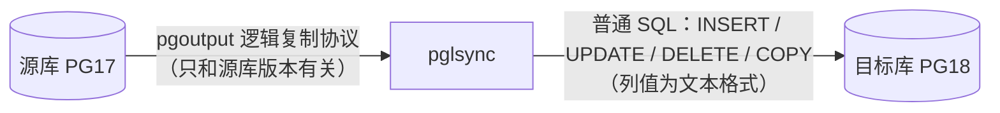

# 源库与目标库 PostgreSQL 版本不一致时的注意事项

以源库 **PG17**、目标库 **PG18** 为例。

## 结论

**可以正常同步。从低版本同步到高版本，正是逻辑复制最常见的用法之一**（例如用逻辑复制做跨大版本升级）。pglsync 的设计本身就不依赖两边版本一致，只需要注意下面几个配套事项。

---

## 1. 为什么版本不一致也没问题



| 环节 | 和版本的关系 |
|---|---|
| 读取变更 | 用的是**源库**的 `pgoutput` 插件，协议版本 1（PG10 及以上都支持）。目标库的版本**完全不参与** |
| 写入目标库 | 就是普通的 SQL 语句和 `COPY`，和普通应用程序连数据库没有区别。不使用 PG 原生的“订阅”功能，所以不存在订阅端与发布端的版本兼容问题 |
| 列值格式 | 全程使用 PostgreSQL 的**文本格式**：源库用 PG17 的输出格式生成，目标库用 PG18 的输入函数解析。文本格式在大版本之间保持向后兼容，这和 `pg_dump` 从低版本导入高版本是同一个原理 |
| 全量复制（`init`/`resync`） | `COPY ... TO STDOUT`（PG17）→ `COPY ... FROM STDIN`（PG18），同样使用文本格式 |
| 位点表 | 目标库上的 `pglsync.sync_state` 只用到 `text`、`pg_lsn`、`timestamptz` 这几种基础类型，所有版本都支持 |

---

## 2. 需要注意的事项

### 2.1 建表时用新版本（PG18）的 pg_dump

从源库导出表结构时，**使用目标库版本（PG18）的 `pg_dump` 客户端**：

```bash
/usr/pgsql-18/bin/pg_dump -h <源库> -p 5432 -U postgres -s -t ... typhoon > schema.sql
psql -h <目标库> -U postgres -d typhoon -f schema.sql
```

PostgreSQL 官方的规则是：**新版本的 pg_dump 可以导出旧版本的库，而且导出的 SQL 保证能在新版本上执行**；反过来则不保证。

### 2.2 TimescaleDB 版本

| 要求 | 说明 |
|---|---|
| 目标库的 TimescaleDB 必须支持 PG18 | TimescaleDB 每个版本只支持特定的几个 PG 大版本，请查阅官方的版本支持表，选择同时支持 PG17 和 PG18 的版本 |
| 两边的 TimescaleDB 版本尽量一致 | 不一致通常也能同步，因为写入目标库走的是普通 SQL，超表会自动把数据路由到 chunk |
| 超表定义保持一致 | 目标库上同样执行 `create_hypertable(...)`；分块间隔、压缩策略、保留策略按需要分别配置 |

pglsync 是在**源库**上把 chunk 映射回超表的（通过 `pg_inherits`），不依赖目标库的 TimescaleDB 内部结构。

### 2.3 认证方式：PG18 开始不推荐 md5 密码认证

PG18 把 **MD5 密码认证**标记为已弃用（仍然可用，但会输出警告），后续版本会移除。建议目标库的密码和 `pg_hba.conf` 都改用 `scram-sha-256`：

```sql
-- 在 PG18 上
SET password_encryption = 'scram-sha-256';
ALTER ROLE postgres PASSWORD '新密码';      -- 重新设置密码，以 SCRAM 方式存储
```

```
# pg_hba.conf
host    typhoon   postgres  192.168.234.0/24    scram-sha-256
```

客户端驱动都支持 SCRAM：

- Python 版的 psycopg2-binary 自带新版 libpq；
- Java 版的 pgjdbc 从 42.2 起支持（项目已升级到 42.7.4）。

### 2.4 数据核对（reconcile）不受排序规则差异影响

`reconcile` 和 `init --no-copy` 会在两边分别计算“行数 + 整行哈希”再比较。两边版本不同时，有两点可能造成**误报**（数据其实一致，却显示不一致）：

| 风险 | 处理 |
|---|---|
| **排序规则差异**：两台服务器的 glibc / ICU 版本不同时，同一个文本主键的排序结果可能不一样，导致拼接顺序不同、哈希不同 | **已处理**：计算哈希时改为按主键的文本表示 + `COLLATE "C"`（按字节）排序，与两边的排序规则无关 |
| **个别类型的文本输出格式变化**：大版本之间偶尔会调整某些类型的输出格式（历史上 PG12 调整过浮点数的默认输出） | 核对时两边都会统一设置 `extra_float_digits`、`DateStyle`、`IntervalStyle`、`bytea_output`、`TimeZone`，常见类型不受影响。如果某张表持续报告不一致，用 `reconcile --detail` 查看具体的行，对比两边的值 |

> 这两点都只影响**核对结果的显示**，不影响实际写入目标库的数据。

### 2.5 目标库是 PG18 时需要留意的行为变化

| PG18 变化 | 对同步的影响 |
|---|---|
| 生成列（`GENERATED ALWAYS AS ...`）不写 `STORED` 时默认变成**虚拟列** | 用 PG18 的 pg_dump 导出 PG17 的表时，会显式写出 `STORED`，结构保持一致。生成列本来就不参与同步，由目标库自己计算，所以无论是虚拟列还是存储列都不影响 |
| `initdb` 默认开启数据页校验和 | 不影响 |
| 弃用 MD5 认证 | 见 2.3 节 |

### 2.6 驱动版本

| 实现 | 驱动 | 说明 |
|---|---|---|
| Python 版 | psycopg2-binary 2.9.x | 离线包会自动选择与目标 Python 匹配的最新 2.9.x，自带 libpq，可以连接 PG17/18 |
| Java 版 | pgjdbc **42.7.4** | 已从 Spring Boot 2.7 默认的 42.3.x 升级，对新版本 PostgreSQL 的支持更好，仍然兼容 JDK 8 |

---

## 3. 反过来：从高版本同步到低版本

比如源库 PG18、目标库 PG17。**一般也能工作**，但有额外的风险：

- 源库用了高版本才有的数据类型、函数或语法（比如在默认值、生成列里用了 PG18 的新函数），目标库上就建不出相同的表；
- 高版本的 pg_dump 导出的 SQL **不保证**能在低版本上执行，需要手工调整。

如果确实需要这样同步，建议先在测试环境用 `init` + `reconcile` 完整验证一遍。

---

## 4. 上线前的检查清单

- [ ] 用 **PG18 的 pg_dump** 导出表结构，并导入目标库；
- [ ] 目标库安装了支持 PG18 的 TimescaleDB，两张超表已经 `create_hypertable`；
- [ ] 目标库的 `pg_hba.conf` 使用 `scram-sha-256`，并且允许同步程序所在的机器连接；
- [ ] 执行 `check`、`setup`、`init`（或 `init --no-copy`）、`run`；
- [ ] 用 `load_writer` 写入几轮测试数据后执行 `reconcile`，全部一致；
- [ ] 如果有包含特殊类型的表（数组、`jsonb`、`interval`、自定义类型等），用 `reconcile --detail` 抽查一下。
